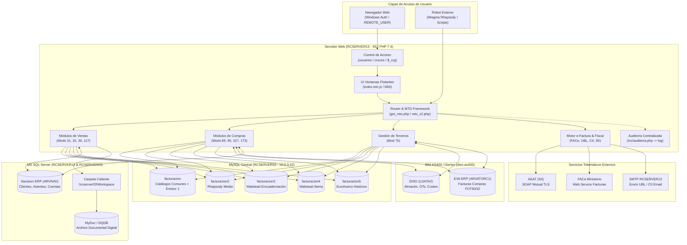
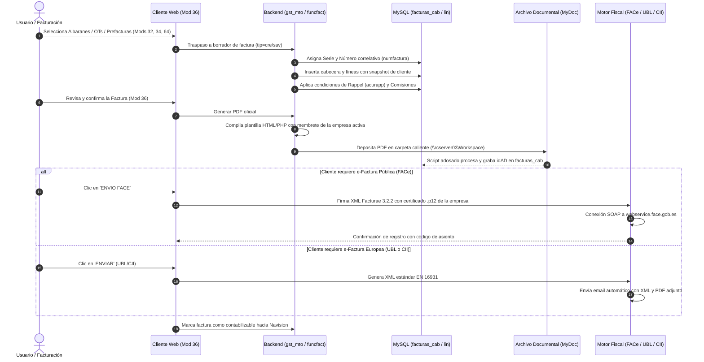
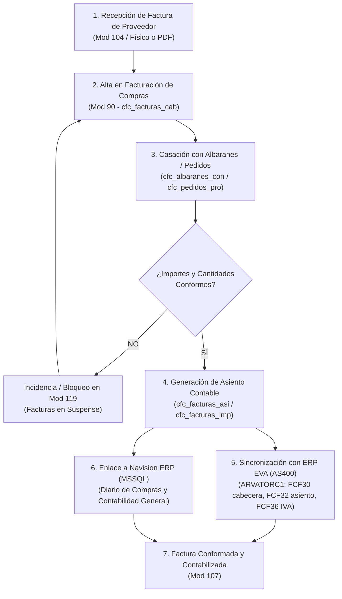
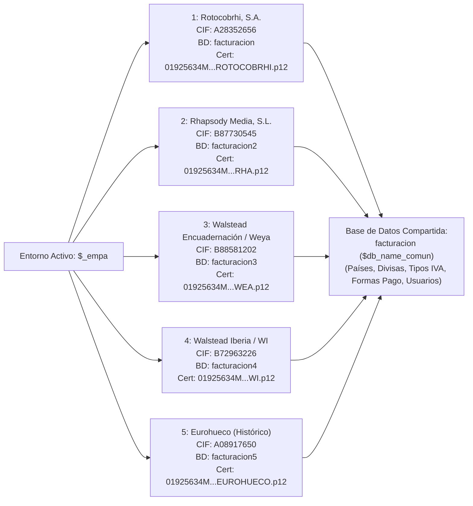

# MANUAL DE ARQUITECTURA, MÓDULOS Y CONEXIONES: SISTEMA FACTURACIÓN

> **Documento de Auditoría y Arquitectura Técnica**  
> **Ubicación del Código:** `\\rcserver13\wwwroot\facturacion`  
> **Servidor Web y Entorno:** Windows Server / Microsoft IIS / PHP 7.4  
> **Frontend:** jQuery / MTD Window Framework (MDI)  
> **Organización Empresarial:** Grupo Walstead (Rotocobrhi, Rhapsody Media, Walstead Encuadernación / Weya, Walstead Iberia, Eurohueco)

---

## 1. Resumen Ejecutivo y Propósito del Sistema

El sistema **Facturación** es una aplicación web empresarial concebida como un **hub transversal de facturación, compras, liquidaciones y pasarelas ERP**. Su función principal no es ser un ERP aislado, sino una capa integradora que conecta y automatiza la facturación entre los talleres de producción gráfica/industrial, los sistemas de gestión legacy (AS400), los ERPs modernos (Navision) y las plataformas fiscales telemáticas (FACe, AEAT/SII, EDI, Factura Electrónica Europea).

### Capacidades Esenciales:
1. **Facturación Emitida (Ventas):** Facturación de pedidos, albaranes, órdenes de trabajo (OTs), prefacturas de talleres (rotativas, máquinas planas, encuadernación, preimpresión) y proyectos externos.
2. **Facturación Recibida (Compras y Conformación):** Recepción de facturas de proveedores, casación contra albaranes y pedidos de compra, generación de asientos contables y sincronización con el ERP contable.
3. **Gestión Maestra de Terceros:** Mantenimiento unificado de clientes y proveedores, contactos, múltiples direcciones, acuerdos de rappel y sincronización con planta.
4. **Liquidación de Comisiones y Rappels:** Cálculo escalonado de rappels diferidos y devengo de comisiones a agentes comerciales.
5. **Facturación Electrónica y Fiscal:** Generación y firma XAdES de Facturae 3.2.2 (FACe), formatos europeos UBL 2.1 y UN/CEFACT CII (Factur-X), suministro telemático inmediato de información a la AEAT (SII), Modelo 349 e Intrastat.
6. **Archivo Documental Digital (MyDoc / DQUIJOTE):** Generación automática de PDFs con sellado, depósito en carpetas calientes y vinculación bidireccional con identificadores documentales (`idAD`).
7. **APIs y Robots Automáticos:** Endpoints desatendidos (`interface.php`) para la facturación automática de proyectos desde herramientas de gestión como iMagina.

---

## 2. Diagramas de Flujo y Arquitectura

### 2.1 Arquitectura General del Sistema y Conexiones

---

### 2.2 Ciclo de Vida de Facturación Emitida (Ventas)

---

### 2.3 Ciclo de Facturación Recibida (Compras y Conformación de Proveedores)

---

### 2.4 Matriz Multi-Empresa

El sistema opera con una única instancia de código que atiende de forma transparente a cinco entidades corporativas:

---

## 3. Catálogo Exhaustivo de Módulos

Los módulos están organizados por numeración en la carpeta `mods/`:

| Módulo | Nombre / Fichero | Tipo MTO | Funcionalidad y Reglas de Negocio |
| :---: | :--- | :---: | :--- |
| **10** | **Empresas** (`10.php`) | M (MTO v2) | Mantenimiento de empresas emisoras (`emisor`): CIF, razón social, datos registrales, configuración de logotipos y enlaces a BBDD. |
| **11** | **Permisos** (`11.php`) | Libre | Matriz de seguridad: asignación de permisos usuario-módulo en la tabla `cruces` y definición de credenciales operativas. |
| **12-14** | **Países, Regiones, Sectores** (`12.php`, `13.php`, `14.php`) | M (MTO v2) | Catálogos geográficos internacionales y sectores económicos para clasificación estadística de clientes. |
| **15** | **Divisas** (`15.php`) | M (MTO v2) | Catálogo de monedas extranjeras y tipos de cambio históricos (`cotizaciones`). |
| **16-17** | **Formas y Medios de Pago** (`16.php`, `17.php`) | M (MTO v2) | Definición de plazos (días, meses) y vías de pago (transferencia, pagaré, confirming, domiciliación). |
| **18** | **Tipos de IVA** (`18.php`) | M (MTO v2) | Porcentajes impositivos de IVA y recargo de equivalencia por fecha de vigencia. |
| **19** | **Agentes Comerciales** (`19.php`) | M (MTO v2) | Ficha de representantes y agentes con condiciones porcentuales de intermediación. |
| **21** | **Expedientes MAPFRE** (`21.php`) | M (MTO v2) | Gestión y seguimiento de siniestros y expedientes de aseguramiento con MAPFRE. |
| **22** | **Comprobar Clientes** (`22.php`) | Libre | Validación de duplicidades, NIFs incorrectos y congruencia fiscal de clientes. |
| **23-24** | **Grupos y Divisiones** (`23.php`, `24.php`) | M (MTO v2) | Agrupaciones mercantiles de clientes y división interna de productos (rotativa, plana, etc.). |
| **26** | **Acuerdos de Rappels** (`26.php`) | M (MTO v2) | Configuración de descuentos diferidos por volumen (por cliente o grupo corporativo) con escalas porcentuales. |
| **28** | **Interface Adquira** (`28.php`) | M (MTO v2) | Integración telemática de pedidos y facturación electrónica con el portal Adquira (Telefónica). |
| **30** | **Interface Navision** (`30.php`) | M (MTO v2) | Monitor y visor de facturas y asientos sincronizados con Microsoft Dynamics Navision. |
| **31** | **Albaranes de Entrega** (`31.php`) | M (MTO v2) | Gestión de albaranes de salida de producto terminado desde talleres/almacén hacia clientes. |
| **32** | **Albaranes a Facturas** (`32.php`) | M (MTO v2) | Asistente de facturación agrupada: convierte albaranes pendientes en facturas de venta oficiales. |
| **33** | **Desbloqueo de Prefacturas** (`33.php`) | M (MTO v2) | Liberación administrativa de prefacturas retenidas por discrepancias o aprobaciones pendientes. |
| **34** | **Traspasar Prefacturas** (`34.php`) | M (MTO v2) | Motor batch de traspaso masivo de prefacturas valoradas a facturas de venta vivas. |
| **35** | **Facturas LIDL** (`35.php`) | Libre | Adaptador específico de facturación para la cuenta comercial de LIDL Supermercados. |
| **36** | **Facturación de Ventas** (`36.php`) | M (MTO v2) | **Módulo estrella de ventas:** Gestión integral de facturas emitidas, rectificativas, emisión PDF, FACe, UBL, CII, pedidos cliente y archivo MyDoc. |
| **37** | **Contadores** (`37.php`) | M (MTO v2) | Control administrativo de los correlativos numéricos de facturación por ejercicio fiscal y serie. |
| **39-40** | **Comisiones y Liquidaciones** (`39.php`, `40.php`) | M (MTO v2) | Cálculo automático de comisiones devengadas por venta y liquidaciones periódicas a comisionistas. |
| **48-49** | **Expedientes y Liq. sin Asignar** (`48.php`, `49.php`) | Libre | Bandejas de entrada de expedientes y liquidaciones pendientes de asignación formal. |
| **50** | **Interfaz con DISO** (`50.php`) | M (MTO v2) | Pasarela de comunicación bidireccional con el sistema de producción AS400 DISO. |
| **52** | **Vista Previa** (`52.php`) | Libre | Previsualización en pantalla de los documentos oficiales antes de su emisión y sellado. |
| **64** | **Asignar Albaranes** (`64.php`) | M (MTO v2) | Vinculación y conciliación de albaranes de entrega contra órdenes de trabajo (OTs). |
| **66** | **Órdenes de Trabajo (OTs)** (`66.php`) | M (MTO v2) | Seguimiento de OTs de producción gráfica y su estado de facturación. |
| **67** | **Conceptos de Facturación** (`67.php`) | M (MTO v2) | Catálogo de conceptos estándar facturables (tirada, encuadernación, transporte, etc.). |
| **75** | **Terceros (Clientes/Proveedores)** (`75.php`) | M (MTO v2) | **Módulo central de entidades:** Gestión completa de clientes, proveedores, direcciones, DIR3, e-factura y sincronización AS400. |
| **76** | **Numeraciones** (`76.php`) | M (MTO v2) | Definición de series de facturación legal (normales, rectificativas, abonos, talleres). |
| **77** | **Fras. Comisiones sin Asignar** (`77.php`) | Libre | Control de facturas de intermediación pendientes de devengar o liquidar. |
| **78** | **Scripts y Mantenimiento** (`78.php`) | Libre | Panel de administración para ejecutar rutinas batch de corrección y sincronización. |
| **80** | **Nomenclaturas** (`80.php`) | M (MTO v2) | Mapeo de términos y equivalencias de códigos entre sistemas legacy y modernos. |
| **82-83** | **Descuentos y Responsables** (`82.php`, `83.php`) | M (MTO v2) | Catálogo de tipos de descuento y asignación de gestores responsables por cuenta. |
| **84-87** | **Contratos y Activos Proveedor** (`84.php` a `87.php`) | M (MTO v2) | Gestión de contratos marco de compra, activos fijos arrendados, períodos y prealbaranes por contrato. |
| **89** | **Albaranes de Conformación** (`89.php`) | M (MTO v2) | Recepción física y comprobación de albaranes de proveedores antes de autorizar la factura. |
| **90** | **Facturas de Compra** (`90.php`) | M (MTO v2) | **Módulo central de compras:** Registro de facturas recibidas, casación con albaranes, desglose IVA/IRPF, asientos y replicación EVA/AS400. |
| **91** | **Asientos de Cierres** (`91.php`) | M (MTO v2) | Generación y control de asientos contables de periodificación y cierre de compras. |
| **93-94** | **Novedades y Calendario** (`93.php`, `94.php`) | M (MTO v2) | Sistema de avisos emergentes para usuarios y calendario laboral/financiero. |
| **96-97** | **Claves Contables** (`96.php`, `97.php`) | M (MTO v2) | Configuración de cuentas y subcuentas contables generales y específicas de materiales. |
| **98** | **Forzar Importación** (`98.php`) | Libre | Herramienta de contingencia para forzar la ingesta de documentos bloqueados. |
| **99** | **Borrado Seguro de Facturas** (`99.php`) | Libre | Utilidad restringida para anular la última factura de venta con reajuste de contador y semáforo `B14`. |
| **102-105** | **DISO y Recepción Compras** (`102.php` a `105.php`) | Mixto | Borrado de cálculos DISO (102), regularizaciones (103), registro de facturas recibidas (104) y contadores de compras (105). |
| **107** | **Facturas Conformadas** (`107.php`) | M (MTO v2) | Consulta y gestión de facturas de compra debidamente aprobadas y autorizadas para pago. |
| **112** | **KPIs e Importación Budget** (`112.php`) | Libre | Carga masiva y seguimiento de presupuestos de ingresos y costes. |
| **114-116** | **Envíos EH e Importador DISO** (`114.php` a `116.php`) | Mixto | Control de envíos Eurohueco (114), importación batch de partes DISO/OSID (115) y numeraciones de compras (116). |
| **117** | **Mantenimiento de Albaranes** (`117.php`) | M (MTO v2) | Corrección administrativa de líneas, precios y cantidades en albaranes ya emitidos. |
| **119** | **Facturas Compra sin Asignar** (`119.php`) | Libre | Bandeja de discrepancias: facturas de proveedor que no cuadran con ningún albarán o pedido. |
| **125-129** | **Mantenimiento y Reversión** (`125.php` a `129.php`) | Libre | Reactivación terceros DISO (125), desmarcar contabilización ventas (126), desmarcar Adquira (127), borrado compras (128), reversión contable compras (129). |
| **130-132** | **Editores de Pasarelas** (`130.php` a `132.php`) | Libre | Corrección directa de registros en colas de sincronización Navision (130), EVA (131) y Facturae (132). |
| **133-136** | **Utilidades de Almacén y Sesiones** (`133.php` a `136.php`) | Libre | Borrado de albaranes DISO (133), antigüedad archivo digital (135), reset de sesiones bloqueadas en Navision (136). |
| **137-140** | **EDI Mercadona y Terceros** (`137.php` a `140.php`) | Mixto | Intermediarios (137), interfaz EDI Mercadona (138), desmarque Mercadona (139), desactivación terceros DISO (140). |
| **141** | **Rappels** (`141.php`) | M (MTO v2) | Cálculo, revisión y ejecución de liquidaciones periódicas de acuerdos sobre rappels. |
| **142-147** | **Prefacturas de Talleres Madrid** (`142.php` a `147.php`) | M (MTO v2) | Prefacturas de encuadernación (142), materiales y papel (144), exportación de materiales a Navision (146), preimpresión (147). |
| **150-154** | **Documentos y Compras** (`150.php` a `154.php`) | Mixto | Documentos sin asignar (150), simulación de precios de entrega (151), pedidos de compra a proveedores (154). |
| **155-167** | **Prefacturas Plana y Barcelona** (`155.php` a `167.php`) | M (MTO v2) | Impresión Plana Madrid (155), Encuadernación BCN (159), Plana BCN (162, 165) y sus respectivos conceptos de facturación. |
| **170-173** | **Navision, Bancos y Espejo EVA** (`170.php` a `173.php`) | Mixto | Importación de terceros Navision (170), Cuentas bancarias IBAN/BIC (171), Visor en vivo de facturas proveedores AS400 EVA (173). |

---

## 4. Mapa Detallado de Conexiones de Base de Datos

| Sistema / Servidor | Driver / Protocolo | Base de Datos / Librería | Credenciales / Conexión | Función / Variable PHP | Finalidad Operativa |
| :--- | :--- | :--- | :--- | :--- | :--- |
| **MySQL Central** `10.0.3.42` (`RCSERVER03`) | MySQLi (`p:` persistente, UTF-8) | `facturacion` `facturacion2` `facturacion3` `facturacion4` `facturacion5` | Usuario: `wwwrun` Password: `runwww` | Global **`$lki`** (según `$db_name` en `inc/dbconnect.php`) | Base de datos activa según la empresa seleccionada. Aloja facturas, líneas, albaranes, terceros, usuarios, cruces y log de auditoría. |
| **MySQL Catálogos** `10.0.3.42` (`RCSERVER03`) | MySQLi (`p:` persistente) | `facturacion` | Usuario: `wwwrun` Password: `runwww` | Variable **`$db_name_comun`** | Catálogo compartido para todas las empresas: divisas, países, provincias, tipos impositivos, formas de pago y emisores. |
| **MySQL Auxiliares** `10.0.3.42` (`RCSERVER03`) | MySQLi | `documentos` `ldata3` `diso` `reporting` | Usuario: `wwwrun` Password: `runwww` | Punteros en `inc/confhost.php`: `$cf_srv_documentos` `$cf_srv_diso` `$cf_srv_reporting` | Almacenamiento intermedio de documentos indexados, históricos de planta y tablas de reporting analítico. |
| **MySQL iMagina** `10.10.2.145:3306` | MySQLi (comprimido, UTF-8) | `imagina` | Usuario: `wwwrun` Password: `runwww` | **`connectRM()`** en `inc/dbconnect.php` | ERP de Rhapsody Media: proyectos editoriales, publicaciones y prefacturas que factura el robot de `interface.php`. |
| **MySQL Eurohueco** `ehintranet20` | MySQLi (utf8mb4) | `diso` | Usuario: `wwwrun` Password: `runwww` | **`myconnect_eh20()`** en `inc/dbconnect.php` | Intranet de planta Eurohueco: réplica de partes de trabajo y datos de producción. |
| **IBM AS400 / iSeries** `diso-as400` | ODBC (iSeries Access Driver) CCSID=0, DSN nativo | `LDATA2` (DISO) `ARVATORC1` `ARVATOMAD` (EVA) | Usuario: `ROWWWRUN` Password: `RUNWWW` | **`connectAS400_RC()`** en `inc/dbconnect.php` | **DISO:** Almacén y costes de taller. **EVA ERP:** Facturas de compras (`FCF30`), asientos (`FCF32`), albaranes (`FCF22`), retenciones (`FCF36`). |
| **IBM AS400 Eurohueco** `10.0.0.28` | ODBC (iSeries Access Driver) | `LDATA` `ARVATODAT` `ARVATOEH1` | Usuario: `EHWWWRUN` Password: `RUNWWW` | **`connectAS400_EH()`** en `inc/dbconnect.php` | Histórico de compras y partes de trabajo de la factoría de Eurohueco. |
| **Microsoft SQL Server** `RCSERVER13` | SQLSRV nativo / ODBC Native Client 10.0 | `ARVNAV` (ERP Navision) Esquema por empresa | Usuario: `sa` (o `wwwrun`) Config en `servidores.php` | **`cf_con_sqlserverNAVI()`** en `inc/confhost.php` | ERP Navision corporativo: comprobación de clientes, proveedores, cuentas contables y verificación de asientos de diario. |
| **Microsoft SQL Server** `RCSERVER03` | SQLSRV nativo / ODBC Native Client 10.0 | `DQDB` (MyDoc / DQUIJOTE) | Usuario: `ricopia` Password: `ricopia` | **`dqconnect()`** / **`cf_con_sqlserverDQDB()`** | Archivo Documental Digital: tablas `TBL_000xx` y metadatos `MTD_00xxx` para indexar y custodiar los PDFs emitidos. |
| **Agencia Tributaria** `Portales AEAT` | SOAP HTTPS con Mutual TLS (.p12 temporal) | Libros Registro SII | Certificados PKCS#12 en `d:/wwwroot/cfg/certificados/` | **`connect_AEAT()`** en `inc/sii.php` | Suministro Inmediato de Información (SII) de facturas emitidas y recibidas. |
| **FACe (Hacienda)** `webservice.face.gob.es` | Web Service SOAP con firma XAdES | Registro FACe Facturae | Certificados PKCS#12 de cada empresa emisora | **`36_facturae_core.php`** / **`153_face.php`** | Envío automático telemático de facturas electrónicas a organismos públicos. |
| **Servidor SMTP** `RCSERVER12` | SMTP Interno (puerto 25, sin auth) | Envío de correo | Sin credenciales requeridas en red interna | **`ajax/email.php`** / **`efac_envia_ubl.php`** | Despacho por email de facturas electrónicas UBL/CII y alertas del robot. |

---

## 5. Seguridad, Trazabilidad y Auditoría

1. **Autenticación Windows Integrada:** La sesión se delega al servidor web IIS mediante `$_SERVER["REMOTE_USER"]`. No existen formularios manuales de login.
2. **Matriz de Permisos (`cruces`):** Cada combinación de usuario y módulo dispone de un registro en `cruces` con una cadena de permisos `$_crg`. Si el usuario no tiene fila autorizada, la ejecución se interrumpe inmediatamente (`No tiene autorización`).
3. **Auditoría Obligatoria (`inc/auditoria.php`):**
   Toda sentencia `INSERT`, `UPDATE` o `DELETE` y cualquier fallo de consulta se audita llamando a `audita()` o `auditaerr()`.
   Los registros se almacenan en la tabla `facturacion.log` con la siguiente estructura:
   - `Usuario`: Login de red del operador.
   - `Fecha`: Marca temporal exacta.
   - `IP`: Dirección IP de la estación de trabajo.
   - `Tabla`: Base de datos y tabla afectada (ej. `facturacion.facturas_cab`).
   - `Sentencia`: SQL literal ejecutado.
   - `Duracion`: Tiempo de cómputo en segundos.
   - `Marca`: Código identificativo del módulo con tres dígitos (ej. `'036'`, `'075'`, `'090'`) o identificador del proceso automático (`'MTO'`, `'IRH'`).
