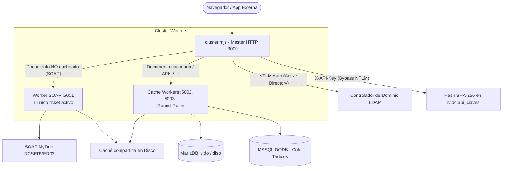

# Revisión Exhaustiva y Análisis de Funcionamiento — iViDo

## Registro de Inspección y Ficheros Analizados

A continuación se detalla la traza de comandos ejecutados y ficheros examinados durante la auditoría técnica de solo lectura:

```text
Ran command: Project root exploration (Get-ChildItem -Force)
Viewed package.json:1-56
Viewed README.md:1-71
Viewed CLAUDE.md:1-250
Viewed CLAUDE.md:251-415
Ran command: Inspect project directory contents (Get-ChildItem -Recurse -File core, conectores, ingesta, scripts | Select-Object FullName, Length | Format-Table -AutoSize)
Ran command: Check ingesta and docs folders (Get-ChildItem ingesta, docs)
Ran command: Check ingesta folder (Get-ChildItem -Force ingesta)
Ran command: Check frontend assets and models (Get-ChildItem -Recurse public, modelos | Select-Object FullName, Length | Format-Table -AutoSize)
Viewed cluster.mjs:1-120
Viewed cluster.mjs:121-250
Viewed cluster.mjs:251-446
Viewed server.mjs:1-150
Ran command: Verify core/server.mjs runs/loads (node -e 'import("./core/server.mjs").catch(e => {});')
Ran command: Find sections and route definitions (powershell -Command "Select-String -Path .\core\server.mjs -Pattern '^(// ===|app\.(get|post|put|delete|use)|export function|export const|async function)' | Select-Object -First 100")
Ran command: Find later sections in server.mjs (powershell -Command "Select-String -Path .\core\server.mjs -Pattern '^(// ===|app\.(get|post|put|delete|use)|export function|export const|async function)' | Select-Object -Skip 100 -First 100")
Viewed server.mjs:10470-10630
Viewed app.mjs:1-121
Viewed sync.mjs:1-125
Viewed logger.mjs:1-100
Viewed as400.mjs:1-143
Viewed conectorEdm.mjs:1-123
Viewed navbar.mjs:1-100
Viewed paginaPrincipal.mjs:1-120
Viewed paginaPrincipal.mjs:200-350
Viewed dashboard.mjs:1-100
Viewed expedientes.mjs:1-100
Viewed retencion.mjs:1-100
Viewed basesDatos.mjs:1-100
Viewed archivar.mjs:1-100
Viewed administracion.mjs:1-100
Viewed server.mjs:1468-1570
Viewed server.mjs:1571-1750
Viewed server.mjs:1751-1850
Viewed API_ARCHIVO.md:1-120
Viewed IVIDO_NATIVO.md:1-110
Viewed clientes.mjs:1-60
```

---

# 1. ¿Qué es iViDo y cuál es su objetivo?

**iViDo** (*Interfaz WEB para MyDoc*) es un servicio documental empresarial desarrollado en **Node.js (ESM + Express 5)** cuyo objetivo fundamental es el **reemplazo progresivo del sistema documental legacy MyDoc / DQ (PHP, IIS, MSSQL)** ubicado en el servidor `RCSERVER03`.

El proyecto no es una simple migración de lenguaje (PHP a Node.js), sino una **estrategia de desacoplamiento y contingencia**:
1. **Convivencia transparente:** Permite consultar los documentos históricos de MyDoc (mediante web service SOAP y base de datos SQL Server `DQDB`).
2. **Capa de contingencia y réplica:** Mantiene un espejo continuo de usuarios, cruces de permisos y catálogo de metadatos en MariaDB (`ivido` y `diso` en `RCSERVER13`), junto con una caché física compartida de PDFs. Si el servidor legacy `RCSERVER03` se apaga o sufre una caída, los documentos ya cacheados siguen estando operativos.
3. **Documentos 100% iViDo (Nativos / Híbridos):** Nuevas agrupaciones documentales (`idTabla >= 100`) y extensiones híbridas que nacen y se gestionan íntegramente en `RCSERVER13`, sin tocar nunca `RCSERVER03`.

---

# 2. Topología de Servidores e Infraestructura

| Servidor | Rol | Componentes y Servicios |
| :--- | :--- | :--- |
| **RCSERVER11** | Entorno de desarrollo | Aloja esta copia de desarrollo. Ejecuta pruebas locales (puerto 3010) y despliega a producción mediante `sync.mjs`. |
| **RCSERVER03** | Servidor legacy | **MSSQL** (`DQDB..TBL_XXXXX`), **MySQL legacy** (`diso`, `calculo`), **Web Service SOAP MyDoc** (`WcfDllAPI/Service1`), carpetas calientes de escáner. |
| **RCSERVER13** | Producción iViDo | Servidor de producción (`\\rcserver13\node.js\iViDo`). Aloja el servicio Windows **iViDo**, la base de datos MariaDB **`ivido`**, el espejo de contingencia MariaDB **`diso`** y la caché centralizada de PDFs. |
| **RCSERVER12** | Servidor de correo | Relay SMTP para envío de notificaciones de cambio de estado y alertas de salud del sistema. |
| **AS/400 (IBM DB2)** | ERP Central | Consulta de solo lectura mediante ODBC (`as400.mjs`) para resolución de metadatos de compras/artículos en tiempo real. |

---

# 3. Arquitectura del Servicio: Master, Workers y Concurrencia

El servicio implementa una arquitectura en **Cluster con enrutamiento inteligente** diseñada para evitar los cuellos de botella característicos de Node.js en tareas de alto consumo de CPU y restricciones de red:



### 3.1. Master (`cluster.mjs`)
- Gestiona la **autenticación NTLM centralizada** contra el Active Directory (`express-ntlm`) o permite el bypass si la petición incluye la cabecera `X-API-Key`.
- **Enrutamiento selectivo:**
  - Si se solicita un PDF (`idTabla` + `idDocumento`) y el fichero ya existe en disco (`isDocumentCached`), lo desvía por **Round-Robin** a los **Cache Workers**.
  - Si el PDF **no está en caché**, lo desvía al **SOAP Worker**.
  - Todas las peticiones HTML, APIs REST, expedientes y vistas se reparten entre los **Cache Workers**.
- Supervisa la salud de los procesos hijos (*health check* cada 10 s) y realiza reinicio automático si un worker cae.
- Apagado ordenado (*graceful shutdown*) con `stopparentfirst`, comunicando vía IPC `shutdown` a los procesos hijos antes de cerrar.

### 3.2. Restricciones críticas de concurrencia gestionadas por el diseño:
1. **Ticket SOAP único:** El API SOAP de MyDoc solo tolera un ticket funcional activo por usuario. Tener múltiples procesos pidiendo tickets provocaría invalidaciones mutuas. Por ello, solo **1 SOAP worker** gestiona SOAP.
2. **CPU-Bound en Node.js:** Manipular PDFs (`pdf-lib`), renderizar códigos de barras (`bwip-js`) y convertir a imagen (`pdf2pic` / GraphicsMagick) bloquea el bucle de eventos. La distribución en workers libera al master y paraleliza el trabajo.
3. **Cola de consultas SQL Server (Tedious):** Tedious no soporta peticiones concurrentes por el mismo socket. Todas las consultas a MSSQL pasan por una cola serializada de promesas (`adQueryQueue` en `server.mjs`).

---

# 4. Núcleo de Procesamiento Documental (`core/server.mjs`)

Es el motor central de la aplicación (~10.000 líneas), encargado de:

### 4.1. El ciclo de vida de visualización (`pdfDoc`):
1. **Comprobación de estado (`SYSESTADO`):**
   - Comprueba si el documento está activo (`SYSESTADO = 1`).
   - Si no está activo, busca un documento sustituto activo con el mismo Código de Barras (`CB`). Si existe, redirige automáticamente (`302`).
   - Si fue borrado (`SYSESTADO = 3` o `4`), limpia las cachés y responde con un error 404 detallado.
2. **Adquisición del PDF:**
   - Si es nativo: se lee directamente de MariaDB y de la ruta local de `ivido`.
   - Si está en caché: lee el buffer directamente de disco y recupera los metadatos desde `ivido.documentos_cache`.
   - Si no está en caché: descarga el Base64 vía SOAP `DownloadFileAsync`, lo persiste en disco y guarda los metadatos en MariaDB.
3. **Estampado al vuelo (*on-the-fly*):**
   Aplica de forma dinámica sobre el documento:
   - Sello/overlay PDF según el estado (`modelos/EST_XX.pdf`).
   - Códigos de barras Code 128 generados con `bwip-js` (en esquina superior derecha o campos personalizados).
   - Textos de estado, fecha de previsión, número de pedido de cálculo.
   - Comentarios procedentes de `expedientes_comentarios`.
   - Pie de página de auditoría de seguridad: usuario AD solicitante, equipo de origen (`Workstation`), tabla, documento y fecha de entrada.

### 4.2. Tareas en segundo plano (`backgroundWorkerLoop`):
El worker SOAP ejecuta un bucle continuo de mantenimiento con **retroceso por actividad (*backoff*)**:
- Si detecta peticiones HTTP recientes de usuarios, se pausa para no competir por CPU ni por el ticket SOAP.
- Cuando no hay actividad humana, alterna entre:
  - **Precarga en goteo (`ejecutarTareaPrecarga`):** Descarga proactivamente documentos pendientes de las tablas configuradas.
  - **Limpieza y auditoría (`ejecutarTareaLimpieza`):** Compara los ficheros cacheados contra MSSQL y elimina de la caché aquellos dados de baja o sustituidos.
  - **Retención nocturna (`ejecutarTareaRetencion`):** Ejecuta la política de expiración documental (por días/meses/años) en modo simulado (*dry-run*) o marcando `SYSESTADO = 3`.

---

# 5. Módulos Funcionales y Navegación

La visibilidad de los módulos en el Navbar y en el Dashboard está centralizada en una única fuente de verdad: `core/navbar.mjs`.

| Módulo | Archivo Core | Descripción y Capacidades |
| :--- | :--- | :--- |
| **Dashboard** | `core/dashboard.mjs` | Portada del sistema (`/`). Renderiza tarjetas de acceso solo a los módulos autorizados. Si el usuario cuenta con el permiso para la aplicación 256 en DISO, muestra la sección **Últimos Documentos** (los 30 documentos más recientes del archivo con auto-refresco cada 60 s). |
| **Workflow** | `core/paginaPrincipal.mjs` | Interfaz principal de consulta documental. Filtros por tipos documentales, estados, personal (calculador, comercial, preparador), rangos de fechas y filtros por columnas de texto (`f_*`). Incluye visualizador integrado en modal y cambios de estado con trazabilidad. |
| **Expedientes Comerciales** | `core/expedientes.mjs` | Gestión de expedientes (`EXPEDIENTES_COMERCIALES`). Muestra cabeceras, vinculación de documentos por `IDEXP`, autocompletado de clientes (`/api/clientes/autocomplete`), cálculo de previsiones y altas/ediciones. |
| **Archivar** | `core/archivar.mjs` | Subida e ingesta manual de documentos PDF. Genera códigos de barras Code 128 opcionales e inyecta los ficheros en la carpeta caliente legacy (`_BD_00025`) o en las agrupaciones nativas. |
| **Retenciones** | `core/retencion.mjs` | Mantenimiento para administradores de las reglas de retención (`expedientes_tablas_retencion`). Edición inline de plazo (`valor` + `días`/`meses`/`años`), modo informativo vs acción y conteo en tiempo real de documentos afectados. |
| **Bases de Datos** | `core/basesDatos.mjs` | Panel de administración de Documentos 100% iViDo. Asistentes para crear nuevas agrupaciones nativas, hibridar tablas existentes de MyDoc y editor interactivo de mapeos lógicos→físicos. |
| **Administración** | `core/administracion.mjs` | Panel de gestión de usuarios, asignación de permisos por tipo documental (Lectura / Escritura), grupos de seguimiento y notificaciones por correo. |

---

# 6. Conectores e Integración con Otros Sistemas

### 6.1. Conector AS/400 (IBM DB2) — `core/as400.mjs`
- Proporciona un cliente ODBC persistente configurado en UTF-8 (`CCSID=1208`).
- Ejecuta consultas serializadas mediante un mutex interno para evitar que el driver de Windows colapse ante concurrencia.
- Aplica reconexión automática transparente en caso de desconexión por inactividad del firewall.
- **Regla estricta:** Solo ejecuta sentencias `SELECT ... FOR READ ONLY` parametrizadas.

### 6.2. Conector EDM (Entradas de Material) — `conectores/conectorEdm.mjs`
- Primer caso piloto del modelo 100% iViDo (`idTabla 100`).
- Lee el código de barras del documento escaneado (`EDM` + nº de pedido + posición), consulta en tiempo real al ERP en el AS/400 (`DMLBS00`, `DMPLF00`, `DMLMA00`, `DSLAD00`) y completa las celdas de metadatos (proveedor, fecha de recepción, material, grupo y propietario) sin intervención manual.

### 6.3. API Externa de Archivo Documental — `docs/API_ARCHIVO.md`
Expone endpoints REST machine-to-machine autenticados con `X-API-Key` (almacenadas como hash SHA-256 en `ivido.api_claves`):
- `GET /api/archivo/existe`: Comprueba si un documento existe y está activo, resolviendo internamente si reside en SQL Server o en MariaDB.
- `GET /api/archivo/buscar`: Búsqueda multicriterio de documentos.
- `POST /api/archivo/subir`: Ingesta directa de PDFs con asignación de metadatos desde otras aplicaciones (requiere clave con permiso de escritura).

---

# 7. Herramientas Operativas y Mantenimiento

- **Gestión como Servicio Windows:** `app.mjs` implementa los comandos `INSTALL`, `START`, `STOP`, `RESTART`, `STATUS` y `UNINSTALL` usando `node-windows`.
- **Despliegue a Producción:** `sync.mjs` (ejecutado con `npm run sync`) sincroniza mediante una lista blanca estricta los módulos necesarios hacia `\\rcserver13\node.js\iViDo` y elimina ficheros huérfanos obsoletos.
- **Auditoría y Corrección de Clientes:** `scripts/clientes.mjs` (ejecutado con `npm run clientes`) analiza expedientes sin NIF y los cruza automáticamente con la base de datos de facturación.
- **Sistema de Logs:** `core/logger.mjs` basado en **Pino + pino-roll**. Genera archivos diarios compartidos en modo append (evitando bloqueos de renombrado concurrente entre workers) y el proceso Master comprime automáticamente los registros de la semana anterior en archivos `.zip`.

---

# Resumen de Estado del Repositorio

- **Integridad del código:** Todo el código fuente sigue el estándar ESM (`.mjs`), con tipado y convenciones alineadas con ESLint + Prettier.
- **Régimen de ejecución:** En desarrollo (`RCSERVER11`), las tareas en segundo plano (`background_tasks.enabled`) se mantienen desactivadas en `config.ini` para evitar colisiones con el ticket SOAP de producción en `RCSERVER13`.
- **Cero modificaciones:** Tal como se solicitó, no se ha modificado ningún archivo de código del proyecto durante esta inspección.
