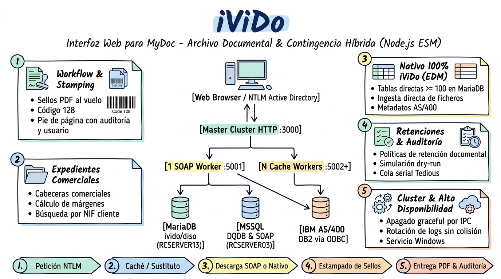
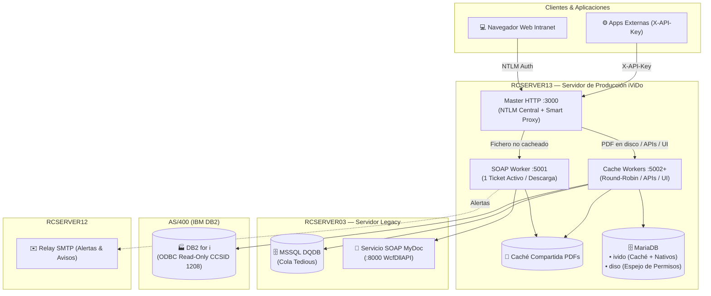
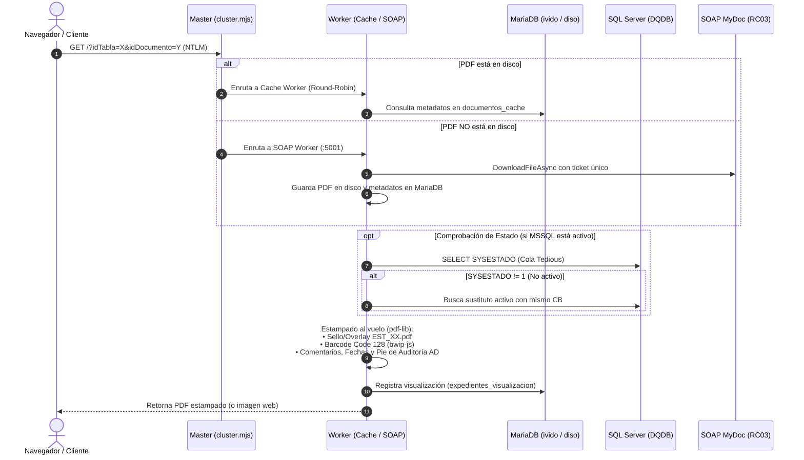

# 📋 iViDo — Sketchnote & Lámina de Arquitectura Técnica

> **iViDo** (*Interfaz WEB para MyDoc*) es el servicio documental en **Node.js (ESM + Express 5)** diseñado para reemplazar progresivamente el sistema legacy **MyDoc / DQ (PHP)** en `RCSERVER03`, proporcionando contingencia total y servicio de documentos nativos desde `RCSERVER13`.

---

## 🎨 Lámina Visual de Arquitectura (Handwritten Notes)

---

## 🏛️ Topología de Infraestructura y Servidores

---

## 📦 Módulos Funcionales Clave

| # | Módulo | Fichero Core | Rol y Capacidades Técnicas |
| :---: | :--- | :--- | :--- |
| **1** | **Dashboard** | [`core/dashboard.mjs`](file:///n:/Fuentes/node.js/iViDo/core/dashboard.mjs) | Landing page interactiva (`/`). Muestra tarjetas a módulos accesibles y la sección **Últimos Documentos** (30 más recientes con auto-refresco cada 60 s). |
| **2** | **Workflow** | [`core/paginaPrincipal.mjs`](file:///n:/Fuentes/node.js/iViDo/core/paginaPrincipal.mjs) | Buscador avanzado con filtros por tipo, fecha, personal y columnas dinámicas (`f_*`). Visor modal y cambio de estados con trazabilidad. |
| **3** | **Expedientes Comerciales** | [`core/expedientes.mjs`](file:///n:/Fuentes/node.js/iViDo/core/expedientes.mjs) | Gestión de carpetas de expedientes, vinculación por `IDEXP`, autocompletado de clientes (`/api/clientes/autocomplete`) y cálculo de márgenes. |
| **4** | **Archivar & Ingesta** | [`core/archivar.mjs`](file:///n:/Fuentes/node.js/iViDo/core/archivar.mjs) | Subida manual de PDFs, generación opcional de código de barras Code 128 y depósito en carpetas calientes (`_BD_00025` o nativas). |
| **5** | **Retenciones Documentales** | [`core/retencion.mjs`](file:///n:/Fuentes/node.js/iViDo/core/retencion.mjs) | Mantenimiento para administradores de políticas de caducidad documental (`expedientes_tablas_retencion`) con conteos en tiempo real. |
| **6** | **Bases de Datos Nativas** | [`core/basesDatos.mjs`](file:///n:/Fuentes/node.js/iViDo/core/basesDatos.mjs) | Asistentes para crear agrupaciones 100% iViDo (`idTabla >= 100`), hibridación de tablas MyDoc y editor de mapeos lógicos→físicos. |
| **7** | **Conector EDM (DB2)** | [`conectores/conectorEdm.mjs`](file:///n:/Fuentes/node.js/iViDo/conectores/conectorEdm.mjs) | Resuelve en tiempo real metadatos de pedidos de compra en el ERP AS/400 tras el escaneo de albaranes de entrada de material. |
| **8** | **API de Archivo Externa** | [`docs/API_ARCHIVO.md`](file:///n:/Fuentes/node.js/iViDo/docs/API_ARCHIVO.md) | Endpoints REST (`/api/archivo/existe`, `/api/archivo/subir`) con autenticación machine-to-machine vía `X-API-Key` (hash SHA-256). |

---

## ⚡ Flujo de Vida de una Petición Documental (`pdfDoc`)

---

## 🛡️ Reglas Críticas de Concurrencia y Resiliencia

1. **Ticket SOAP único:** Solo 1 worker atiende SOAP para evitar colisiones de sesión con el servicio legacy.
2. **Cola Serializada Tedious:** SQL Server no admite peticiones concurrentes por el mismo socket; la cola `adQueryQueue` serializa todas las consultas.
3. **Trabajador de Fondo con Backoff:** El bucle asíncrono alterna precarga y limpieza solo cuando hay inactividad de usuario, pausándose de inmediato si entra tráfico web.
4. **Logs compartidos sin colisión:** Pino con rotación por fecha directa (append) y compresión semanal centralizada en el Master.
