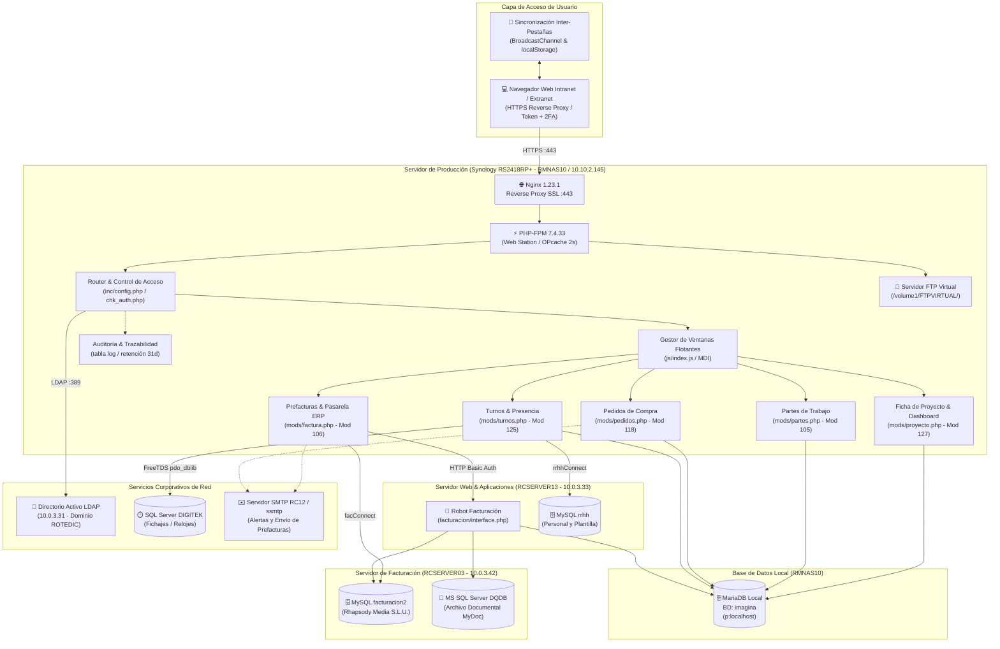
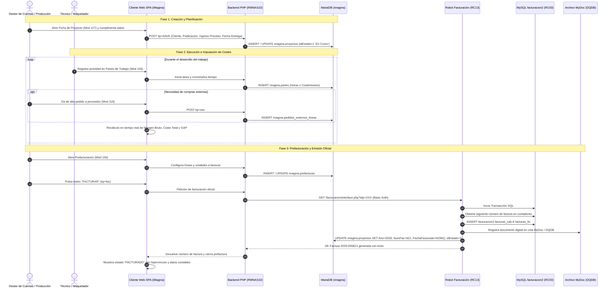
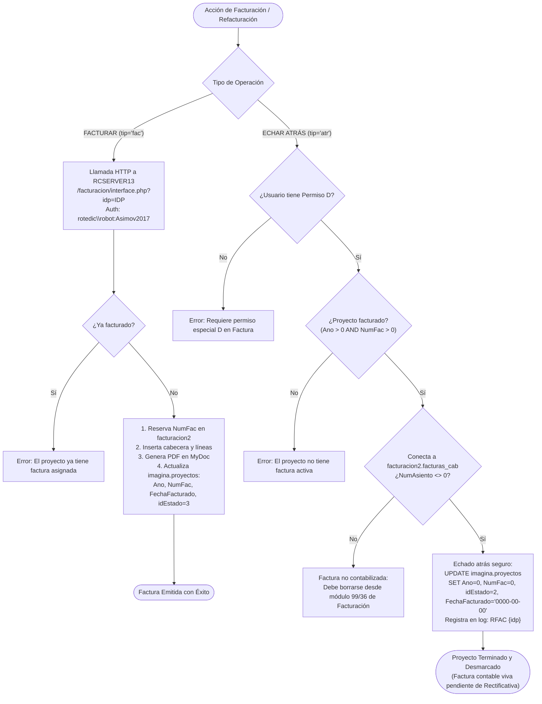
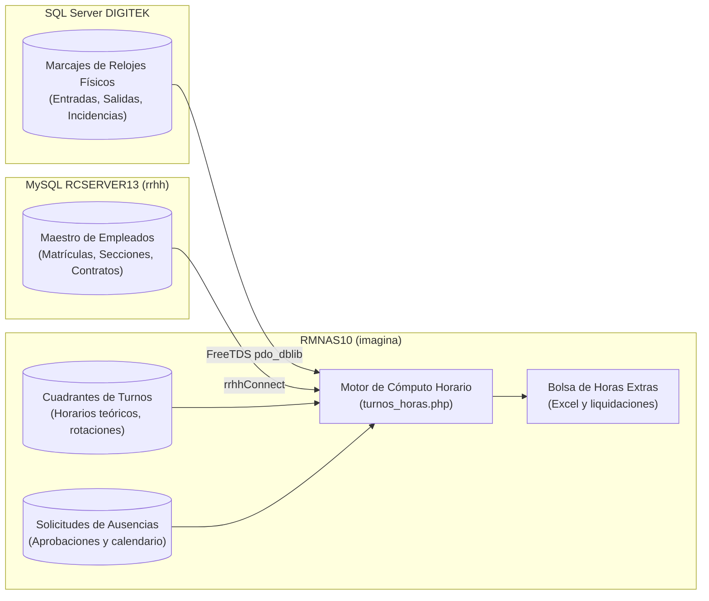
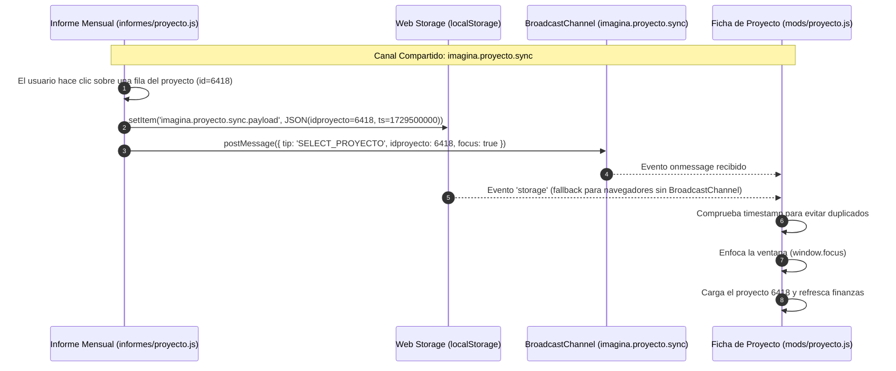

# MANUAL DE ARQUITECTURA, MÓDULOS Y CONEXIONES: SISTEMA IMAGINA

> **Documento de Auditoría y Arquitectura Técnica**  
> **Sistema:** iMagina (Portal de Gestión Gráfica, Operaciones y Prefacturación)  
> **Empresa:** Rhapsody Media S.L.U. (Grupo Walstead / Rotocobrhi)  
> **Servidor Principal:** Synology RS2418RP+ (`RMNAS10` - `10.10.2.145`)  
> **URL Producción:** `https://portal.rotocobrhi.es/imagina/`  
> **Ubicación del Código:** `/volume1/web/imagina/` (`\\10.10.2.145\web\imagina\`)  
> **Stack Técnico:** Nginx 1.23.1 / PHP-FPM 7.4.33 / MariaDB / jQuery 3.7.1 / Lucide Icons / TCPDF / OpenSpout  

---

## 1. Resumen Ejecutivo y Propósito del Sistema

**iMagina** es la plataforma corporativa central de gestión operativa, técnica y financiera desarrollada para **Rhapsody Media S.L.U.**, la división de preimpresión, retoque digital, maquetación editorial y artes finales del **Grupo Walstead Iberia** (vinculada operativamente a la planta gráfica de Rotocobrhi S.A.U.).

El sistema está concebido como una **Single Page Application (SPA)** de arquitectura multi-ventana (interfaz MDI enriquecida) que centraliza el ciclo de vida completo de la producción gráfica publicitaria y editorial:

### Capacidades Esenciales:
1. **Gestión Integral de Proyectos y Publicaciones:** Control unificado de proyectos, campañas de clientes (prensa, revistas, catálogos comerciales, folletos promocionales) y publicaciones periódicas con asignación de márgenes objetivo específicos.
2. **Imputación de Tiempos y Partes de Taller:** Cronometraje y registro pormenorizado de tiempos de producción por operario, puesto y operación gráfica, aplicando de forma instantánea el coste horario de taller.
3. **Subcontratación y Compras Externas:** Gestión de pedidos a proveedores externos (fotomecánica, encuadernación especial, manipulados, transporte) vinculados a proyectos para consolidación de costes en tiempo real.
4. **Motor Financiero Reactivo en Tiempo Real:** Cálculo dinámico e instantáneo en pantalla de costes directos, desviación de tiempos, margen bruto en euros y porcentaje, gap contra el margen objetivo y estado de rentabilidad mediante alertas visuales.
5. **Prefacturación y Pasarela Automatizada al ERP:** Generación de prefacturas valoradas con conceptos tarifarios y emisión automatizada de facturas oficiales hacia el sistema central de **Facturación** (`facturacion2` en `RCSERVER03`) mediante llamada HTTP autenticada a `interface.php`.
6. **Mecanismo de Desfacturación Segura ("Echar Atrás"):** Protocolo de refacturación restringida (permiso `D`) que desvincula facturas contabilizadas para permitir rectificaciones sin comprometer la consistencia contable del ERP.
7. **Control Horario, Fichajes y Cuadrantes de Turnos:** Planificación de cuadrantes laborales, cálculo de bolsa de horas extras y compensadas, y sincronización con el sistema corporativo de presencia **DIGITEK** (SQL Server) y base de datos de RRHH en `RCSERVER13`.
8. **Hub de Intercambio de Archivos FTP:** Gestión y securización de cuentas de acceso al servidor FTP alojado en el propio NAS Synology (`/volume1/FTPVIRTUAL/`), estructurando los repositorios de entrega de artes finales por cliente.
9. **Módulo de Ingesta Masiva ECI:** Procesamiento de ficheros maestros Excel de **El Corte Inglés** mediante streaming de alto rendimiento (`OpenSpout`), automatizando el desglose de promociones, catálogos y páginas.

---

## 2. Diagramas de Flujo y Arquitectura

### 2.1 Arquitectura General del Sistema y Conexiones

---

### 2.2 Ciclo de Vida Integral de un Proyecto Gráfico

---

### 2.3 Circuito de Facturación y Refacturación Segura ("Echar Atrás")

El enlace entre iMagina y el sistema de Facturación se gestiona a través de dos mecanismos complementarios implementados en [`mods/factura.php`](file:///10.10.2.145/web/imagina/mods/factura.php):

---

### 2.4 Control Horario, Fichajes y Cuadrantes de Turnos

El módulo de turnos ([`mods/turnos.php`](file:///10.10.2.145/web/imagina/mods/turnos.php), Mod 125) y presencia ([`mods/presencia.php`](file:///10.10.2.145/web/imagina/mods/presencia.php), Mod 116) implementa una integración híbrida:

---

## 3. Catálogo Exhaustivo de Módulos

A continuación se detalla la totalidad de los módulos que componen el sistema **iMagina**, con su número identificador, archivos asociados y capacidades operativas:

| ID | Nombre del Módulo | Archivos Core | Tipo UI | Propósito y Capacidades Técnicas |
| :---: | :--- | :--- | :--- | :--- |
| **3** | **Estadísticas y Analítica** | `mods/stats.php` `mods/stats.js` | Principal | Cuadro analítico de horas, desviaciones y productividad por cliente, proyecto y operador. Sincronizado vía `BroadcastChannel`. |
| **4** | **Seguridad y Contraseña** | `mods/password.php` `mods/password.js` | Modal / Auth | Cambio de contraseña local, enrolamiento de doble factor (2FA QR TOTP y fallback por email). Obligatorio en primer acceso local. |
| **5** | **Gestión de Usuarios** | `mods/usuarios.php` `mods/usuarios.js` | Principal | Alta y mantenimiento de operadores, asignación de matrícula de personal, correo corporativo, idioma y estado activo/inactivo. |
| **7** | **Empresas** | `mods/empresas.php` `mods/empresas.js` | Auxiliar | Catálogo multi-empresa para segmentar accesos y parametrizaciones dentro del grupo. |
| **8** | **Calendario Laboral** | `mods/calendario.php` `mods/calendario.js` | Principal | Configuración anual de festivos nacionales, autonómicos, locales y días no laborables de fábrica. |
| **9** | **Colores y Perfiles** | `mods/colores.php` `mods/colores.js` | Auxiliar | Mantenimiento de perfiles de color estandarizados (ISO, FOGRA, tintas directas) aplicables a las publicaciones. |
| **12** | **Autorizaciones** | `mods/autorizaciones.php` `mods/autorizaciones.js` | Auxiliar | Bandeja de control para aprobaciones de cambios extraordinarios en proyectos o imputaciones. |
| **13** | **Auditoría y Logs** | `mods/logs.php` `mods/logs.js` | Principal | Visor para administradores de la tabla `log`. Permite filtrar accesos, errores, IPs, navegadores y marcas de auditoría. |
| **100** | **Importación / Exportación CSV** | `mods/csv.php` `mods/csv.js` | Principal | Herramienta batch para la carga masiva y exportación de proyectos, tarifas y datos maestros con mapeo dinámico de columnas. |
| **101** | **Renombrar Artes Finales** | `mods/renombrar.php` `mods/renombrar.js` | Utilidad | Utilidad para la normalización sintáctica de nombres de archivos PDF de páginas según el estándar de imprenta y cliente. |
| **102** | **Catálogo de Operaciones** | `mods/operaciones.php` `mods/operaciones.js` | Principal | Maestro de operaciones técnicas de preprensa (escaneado, retoque, imposición, ripeo, corrección) y sus costes horarios asociados. |
| **103** | **Listado de Proyectos** | `mods/proyectos.php` `mods/proyectos.js` | Principal | Rejilla global de proyectos con filtros multicriterio (cliente, año, estado, fecha de entrega), paginación y apertura de fichas. |
| **104** | **Estados de Flujo** | `mods/estados.php` `mods/estados.js` | Auxiliar | Definición del workflow de estados de un proyecto (1=En Curso, 2=Terminado, 3=Facturado, 4=Retenido, 5=Cancelado). |
| **105** | **Partes de Trabajo** | `mods/partes.php` `mods/partes.js` | Principal | **Control de tiempos de taller:** Cronómetro en vivo por operador, imputación de partes manuales, selección de tarea y cómputo de coste. |
| **106** | **Prefacturas y Facturación** | `mods/factura.php` `mods/factura.js` | Principal | **Hub de facturación:** Confección de partidas a cobrar, enlace con robot `interface.php` en `RCSERVER13` y botón "Echar Atrás" (permiso D). |
| **107** | **Panel de Control** | `mods/control.php` `mods/control.js` | Principal | Monitor en tiempo real para supervisión de jefes de taller: semáforos de plazos, estado de pruebas de color y entregas pendientes. |
| **108** | **Publicaciones Editoriales** | `mods/publicaciones.php` `mods/publicaciones.js` | Principal | Mantenimiento de revistas y catálogos periódicos por cliente. Define el margen objetivo específico (ej. 40%, 45%) de cada cabecera. |
| **109** | **Conceptos Facturables** | `mods/conceptos.php` `mods/conceptos.js` | Principal | Catálogo de conceptos de venta estándar (maquetación, tratamiento digital, pruebas ozalid, PDF certificado) y tarifas base. |
| **110** | **Gestor de Documentos** | `mods/documento.php` `mods/documento.js` | Auxiliar | Repositorio de ficheros adjuntos vinculados a proyectos, especificaciones técnicas y fichas de pedido del cliente. |
| **111** | **Maestro de Clientes** | `mods/clientes.php` `mods/clientes.js` | Principal | Registro unificado de clientes de Rhapsody Media, contactos comerciales, condiciones de pago y configuración de interfaces especiales. |
| **113** | **FTP - Cuentas de Usuario** | `mods/ftp.php` `mods/ftp.js` | Principal | Gestión de credenciales y permisos de lectura/escritura de clientes para el servidor FTP corporativo alojado en el NAS. |
| **114** | **FTP - Servidores Maestro** | `mods/ftpmaestro.php` `mods/ftpmaestro.js` | Auxiliar | Mantenimiento de puntos de montaje y configuraciones maestras de servidores de transferencia. |
| **115** | **FTP - Editor de Estructura** | `mods/ftpeditor.php` `mods/ftpeditor.js` | Principal | Explorador y gestor del árbol de directorios virtuales (`/volume1/FTPVIRTUAL/...`), asignando carpetas raíz por cuenta comercial. |
| **116** | **Presencia y Fichajes** | `mods/presencia.php` `mods/presencia.js` | Principal | Visor diario de marcajes de entrada/salida de la plantilla física, importados desde el servidor de control de presencia corporativo. |
| **117** | **Proveedores Externos** | `mods/proveedores.php` `mods/proveedores.js` | Principal | Catálogo de talleres auxiliares y empresas subcontratadas para compras de producción. |
| **118** | **Pedidos de Compra** | `mods/pedidos.php` `mods/pedidos.js` | Principal | Emisión de pedidos de subcontratación contra proyectos. Controla importes acordados y los consolida como coste directo en la ficha. |
| **120** | **Vacaciones y Ausencias** | `mods/vacaciones.php` `mods/vacaciones.js` | Principal | Solicitud y cuadrante de vacaciones, permisos y ausencias médicas, con envío de alertas automáticas por correo electrónico a supervisores. |
| **121** | **Planificación y Carga de Taller** | `mods/plan.php` `mods/plan_edit.php` | Principal | Diagrama de ocupación por operador y sección gráfica. Genera hojas de ruta impresas de taller (`plan_edit_prn.php`). |
| **123** | **Edición de Usuario (Perfil)** | `mods/editusu.php` `mods/editusu.js` | Modal | Modificación de datos del perfil propio, idioma de la interfaz y configuraciones personales de ventana. |
| **124** | **Arte Final (AF)** | `mods/af.php` `mods/af.js` | Principal | Módulo de homologación de entregas de arte final: validación de páginas recibidas, chequeo de perfiles y pase a producción. |
| **125** | **Turnos y Bolsa de Horas** | `mods/turnos.php` `turnos_bolsa_excel.php` | Principal | Generación de cuadrantes mensuales rotativos, cálculo de saldo de bolsa de horas, y exportación de ficheros oficiales a Excel y PDF. |
| **126** | **Campaña El Corte Inglés** | `mods/eci.php` `mods/eci.js` | Principal | Módulo exclusivo de alta masiva para catálogos y promociones de ECI mediante procesamiento de archivos Excel con streaming `OpenSpout`. |
| **127** | **Ficha de Proyecto & Finanzas** | `mods/proyecto.php` `mods/proyecto.js` | Principal | **Ficha neurálgica:** Datos del proyecto, previsión de ingresos, costes acumulados en vivo, cálculo del margen, GAP y botón al informe mensual. |
| **128** | **Actividad de Operadores** | `mods/actividad.php` `mods/actividad.js` | Principal | Histórico detallado de actividad y tareas ejecutadas por operario a lo largo de la jornada para control de cargas de trabajo. |
| **129** | **Agente Background** | `mods/agente.php` `tools/agente_run.php` | Demonio / Batch | Agente desatendido para sincronizaciones periódicas, purga de sesiones y procesado de colas en segundo plano. |
| **—** | **Informe Financiero Mensual** | `informes/proyecto.php` `informes/proyecto.js` | Reporte | Reporte directivo de cierre mensual de proyectos con exportación a ExcelJS, gráficos agregados y sincronización cross-tab. |
| **—** | **Informe de Facturación** | `informes/factura.php` `informes/factura.js` | Reporte | Cuadro de control mensual de facturas y prefacturas emitidas en Rhapsody Media para conciliación administrativa con contabilidad. |

---

## 4. Mapa Detallado de Conexiones de Base de Datos y Red

| Servicio / Destino | Host / Dirección | Driver / Protocolo | Base de Datos / Recurso | Credenciales / Puerto | Función Arquitectónica |
|---|---|---|---|---|---|
| **MariaDB Local** Servidor Synology | `localhost` (o `10.10.2.145`) | MySQLi persistente (`p:localhost`) Charset: UTF-8 | `imagina` | Usuario: `wwwrun` Password: `runwww` Puerto: 3306 | **Base de Datos Principal:** Almacena usuarios, tokens, accesos, proyectos, partes de trabajo, prefacturas, publicaciones, clientes y logs. |
| **MySQL Facturación** Servidor Central | `10.0.3.42` (`RCSERVER03`) | MySQLi (`facConnect()`) MYSQLI_CLIENT_COMPRESS | `facturacion2` | Usuario: `wwwrun` Password: `runwww` Puerto: 3306 | **Facturación ERP (Rhapsody Media):** Tablas `facturas_cab`, `facturas_lin`, contadores y asientos contables para la empresa 2. |
| **MySQL RRHH** Servidor de Gestión | `10.0.3.33` (`RCSERVER13`) | MySQLi (`rrhhConnect()`) | `rrhh` | Usuario: `wwwrun` Password: `runwww` Puerto: 3306 | **Recursos Humanos:** Plantilla activa, matrículas de empleados, departamentos y categorías laborales. |
| **SQL Server DIGITEK** Relojes de Presencia | `10.0.3.31` / Instancia | PDO FreeTDS (`pdo_dblib`) vía `inc/digitek.php` | BD Presencia Corporativa | Configurada en `/volume1/web/cfg/servidores.php` | **Fichajes Físicos:** Marcajes de entrada y salida reales para el cálculo de turnos y bolsas de horas. |
| **Directorio Activo LDAP** Controlador de Dominio | `10.0.3.31` | PHP LDAP (`ldap_connect`) Puerto 389 (LDAP) | Base DN: `DC=rotedic,DC=arvato-print,DC=es` | Dominio: `ROTEDIC` Sufijo: `arvato-print.es` | **Autenticación Híbrida:** Validación de credenciales de red corporativas de usuarios de dominio de Grupo Walstead. |
| **Robot Facturación Web** Servidor IIS | `10.0.3.33` (`RCSERVER13`) | HTTP GET con Basic Auth | `/facturacion/interface.php` | Usuario: `rotedic\robot` Password: `Asimov2017` Puerto: 80 | **Emisión Automatizada:** Endpoint desatendido que transforma un proyecto de iMagina en factura oficial en `facturacion2` y genera PDF. |
| **Servidor FTP Virtual** NAS Synology | `10.10.2.145` | FTP (Puerto 21) SFTP (Puerto 22) | Sistema de archivos: `/volume1/FTPVIRTUAL/` | Aislamiento por chroot de clientes | **Repositorio Gráfico:** Depósito e intercambio masivo de archivos digitales, artes finales y PDFs certificados de clientes. |
| **Servidor SMTP** Relay de Correo | `10.0.3.12` (`RCSERVER12`) o ssmtp local | SMTP (Puerto 25) PHPMailer | Servicio SMTP sin autenticación interna | Relay local del NAS / Red interna | **Notificaciones y Envío:** Envío de prefacturas a clientes, avisos de solicitudes de vacaciones y códigos de seguridad 2FA. |

---

## 5. Motor Financiero y Reglas de Negocio en Tiempo Real

El sistema implementa en [`mods/proyecto.js`](file:///10.10.2.145/web/imagina/mods/proyecto.js) y [`informes/proyecto.php`](file:///10.10.2.145/web/imagina/informes/proyecto.php) un motor financiero que calcula la rentabilidad al vuelo:

### 5.1 Fórmulas Matemáticas de Rentabilidad

1. **Coste Directo Total:**
   $$\text{Coste Total} = \text{Pedidos Externos} + \text{Coste de Partes}$$
   Donde:
   $$\text{Coste de Partes} = \sum_{i=1}^{n} (\text{Horas Registradas}_i \times \text{Coste Horario Operación}_i)$$

2. **Base de Ingreso (Base de Resultado):**
   $$\text{Base} = \begin{cases} \text{Total Prefactura / Factura}, & \text{si el proyecto está facturado (FechaFacturado <> '0000-00-00')} \\ \text{Ingreso Previsto}, & \text{si el proyecto sigue en curso} \end{cases}$$

3. **Margen Bruto (Euros y Porcentaje):**
   $$\text{Margen Bruto (€)} = \text{Base} - \text{Coste Total}$$
   $$\text{Margen Bruto (\%)} = \begin{cases} \left(\frac{\text{Margen Bruto (€)}}{\text{Base}}\right) \times 100, & \text{si Base} > 0 \\ 0, & \text{si Base} \le 0 \end{cases}$$

4. **Margen Objetivo y GAP:**
   $$\text{Margen Objetivo (€)} = \text{Base} \times \left(\frac{\text{Margen Objetivo Publicación (\%)}}{100}\right)$$
   $$\text{GAP Financiero (€)} = \text{Margen Bruto (€)} - \text{Margen Objetivo (€)}$$
   $$\text{Índice de Margen} = \max\left(0, \frac{\text{Margen Bruto (€)}}{\text{Margen Objetivo (€)}}\right)$$

5. **Porcentaje de Realización:**
   $$\text{Realización (\%)} = \begin{cases} \left(\frac{\text{Total Imputado}}{\text{Ingreso Previsto}}\right) \times 100, & \text{si Ingreso Previsto} > 0 \\ 0, & \text{si Ingreso Previsto} \le 0 \end{cases}$$

### 5.2 Clasificación de Estados Financieros

| Estado Financiero | Criterio de Activación | Significado Visual / Semáforo |
|---|---|---|
| **SIN PREVISTO** | $\text{Base} \le 0$ | Proyecto sin importe económico configurado. Fondo gris neutral. |
| **PÉRDIDA (REAL / PREVISTA)** | $\text{Margen Bruto (€)} < 0$ | Los costes superan a los ingresos. Fondo rojo crítico. |
| **BAJO OBJETIVO** | $\text{Margen Bruto (\%)} < \text{Margen Objetivo (\%)} - 5\%$ | El margen obtenido queda más de 5 puntos por debajo del objetivo. Fondo naranja de alerta. |
| **RIESGO** | $\text{Margen Objetivo (\%)} - 5\% \le \text{Margen Bruto (\%)} < \text{Margen Objetivo (\%)}$ | En el margen de tolerancia pero por debajo del objetivo. Fondo amarillo de precaución. |
| **OBJETIVO OK** | $\text{Margen Bruto (\%)} \ge \text{Margen Objetivo (\%)}$ | El proyecto cumple o supera el objetivo de rentabilidad fijado. Fondo verde óptimo. |

---

## 6. Sincronización Reactiva Inter-Pestañas

Para maximizar la productividad de los gestores, iMagina sincroniza automáticamente las ventanas abiertas en distintas pestañas del navegador mediante **`BroadcastChannel`** y **`localStorage`**:

---

## 7. Seguridad, Autenticación Híbrida y Auditoría

1. **Autenticación Híbrida (AD / Local):**
   - El sistema comprueba primero la autenticación del usuario contra el Directorio Activo corporativo (`10.0.3.31`).
   - Si el usuario no pertenece al dominio, se valida su hash de contraseña en la base de datos local `imagina.usuarios`.
   - Si un usuario local no tiene contraseña configurada, el sistema bloquea el acceso a todos los módulos y redirige de forma forzada al módulo 4 (`password.php`).

2. **Doble Factor de Autenticación (2FA):**
   - Compatible con aplicaciones de autenticación estándar (Google Authenticator, Microsoft Authenticator) mediante **TOTP QR**.
   - Opción de fallback con código numérico de 6 dígitos enviado por correo electrónico (`ajax/chk_2fa.php`).
   - Opción de "Dispositivo de Confianza" que almacena una cookie segura válida durante 180 días.

3. **Control de Accesos Basado en Tokens:**
   - Sesión controlada por dos cookies persistentes: `img_id` (identificador numérico de token) y `img_token` (hash criptográfico aleatorio generado en `lib/random.php`).
   - Cada llamada AJAX valida el token contra la tabla `imagina.tokens`, verificando que la IP del cliente (`REMOTE_ADDR`) coincida con la que originó la sesión.

4. **Auditoría Centralizada y Purga Automática (`log`):**
   - Cada ejecución de módulo o acción sobre registros invoca la función central `registrar($txt, $idu, $mod, $detalle)`.
   - Almacena en la tabla `imagina.log` la marca temporal exacta, IP del cliente, User Agent completo, plataforma, navegador, versión, usuario, módulo y detalle técnico de la operación.
   - **Purga Probabilística:** Con una probabilidad del 1% en cada inserción, el sistema ejecuta de forma automática una limpieza de registros antiguos según la retención fijada en `$_retention_log = 31` días (`DELETE FROM log WHERE Fecha < DATE_SUB(NOW(), INTERVAL 31 DAY)`), manteniendo la base de datos optimizada sin necesidad de crons externos.
