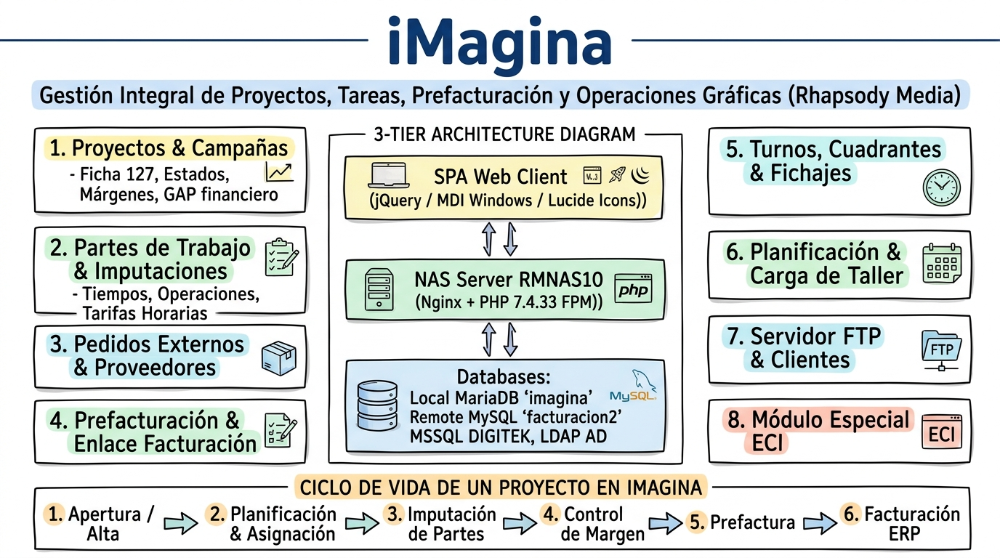
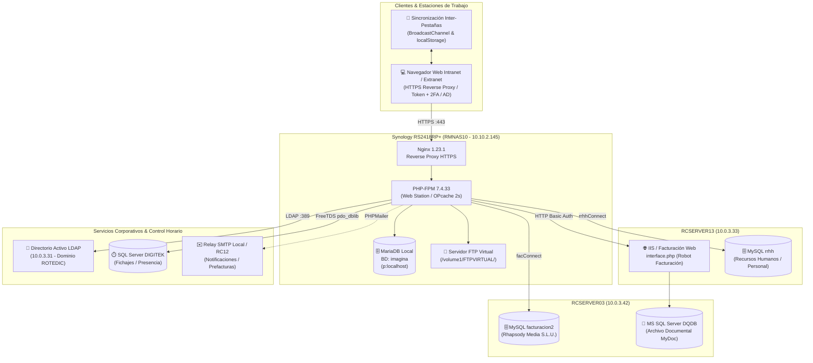
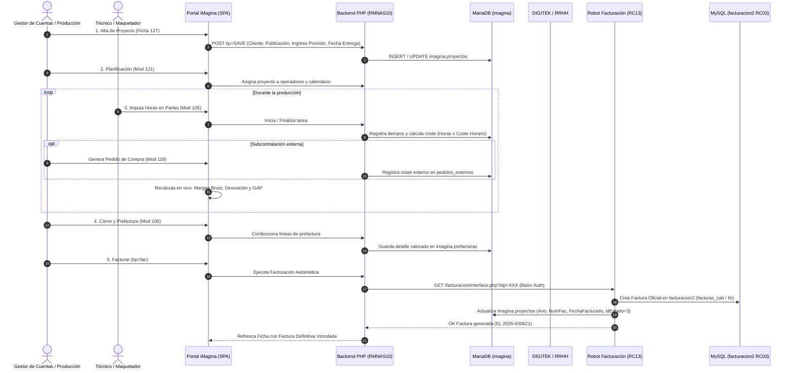

# 📝 iMagina — Sketchnote & Lámina de Arquitectura Técnica

> **iMagina** es el portal web corporativo (**Single Page Application - SPA MDI**) en **PHP 7.4 / FastCGI (Nginx) + MariaDB + jQuery 3.7** alojado en el NAS Synology RS2418RP+ (**`RMNAS10`**), diseñado para la gestión integral de proyectos gráficos, preimpresión, control de tiempos, subcontratación, planificación de recursos y pasarela de facturación automática para **Rhapsody Media S.L.U.** (Grupo Walstead / Rotocobrhi).

---

## 🎨 Lámina Visual de Arquitectura (Handwritten Notes)

---

## 🏗️ Topología de Infraestructura y Servidores

---

## 🧩 Módulos Funcionales Clave

| # | Módulo | Ficheros Core | Rol y Capacidades Técnicas |
| :---: | :--- | :--- | :--- |
| **1** | **Ficha de Proyecto (127)** | `mods/proyecto.php` `mods/proyecto.js` | Centro neurálgico del proyecto. Edición de cabecera, clientes, publicaciones, fechas, estados y **dashboard financiero reactivo en tiempo real** (partes + pedidos vs. ingreso previsto / facturado). |
| **2** | **Partes de Trabajo (105)** | `mods/partes.php` `mods/partes.js` | Registro y cronometraje de horas invertidas por operario y sección. Multiplica unidades/tiempo por coste horario para imputación directa al coste del proyecto. |
| **3** | **Pedidos Externos (118)** | `mods/pedidos.php` `mods/pedidos.js` | Gestión de compras y subcontratación técnica a terceros (encuadernación, fotomecánica, transportes, manipulados). Imputa costes externos en tiempo real al proyecto. |
| **4** | **Prefacturación & Factura (106)** | `mods/factura.php` `mods/factura.js` | Confección de líneas de prefactura valoradas. Botón **FACTURAR** con enlace desatendido al robot de `facturacion/interface.php` en `RCSERVER13` y botón **ECHAR ATRÁS** para refacturación controlada. |
| **5** | **Control & Monitorización (107)** | `mods/control.php` `mods/control.js` | Cuadro de mando operativo para jefes de producción. Semáforos de avance, fechas de entrega, estados y alertas de desviación. |
| **6** | **Turnos & Fichajes (125 / 116)** | `mods/turnos.php` `mods/presencia.php` | Planificación de cuadrantes rotativos, bolsas de horas extras/compensadas, generación de informes Excel/PDF e integración con marcajes de **DIGITEK SQL Server**. |
| **7** | **Planificación de Taller (121)** | `mods/plan.php` `mods/plan_edit.php` | Diagramas visuales de carga de trabajo, asignación de proyectos a operadores, líneas temporales y hojas de producción para impresión (`plan_edit_prn.php`). |
| **8** | **Campaña El Corte Inglés (126)** | `mods/eci.php` `mods/eci.js` | Ingesta masiva y validación mediante `OpenSpout` de hojas XLSX maestras de catálogos y promociones de El Corte Inglés, asignando subcampañas y páginas. |
| **9** | **Servidores & Cuentas FTP (113-115)** | `mods/ftp.php` `mods/ftpeditor.php` | Administración del servidor FTP en el NAS (`/volume1/FTPVIRTUAL/`), gestión de credenciales por cliente y aislamiento de árboles de carpetas para intercambio de artes finales. |
| **10** | **Informe Financiero Mensual** | `informes/proyecto.php` `informes/proyecto.js` | Reporte global de rentabilidad mensual. Agrupa proyectos facturados y previstos, clasifica el cumplimiento de margen objetivo y sincroniza selección bidireccional vía `BroadcastChannel`. |

---

## 🔄 Flujo de Vida de un Proyecto Gráfico en iMagina

---

## ⚡ Motor Financiero en Tiempo Real

El cálculo de rentabilidad del módulo 127 y del informe mensual opera de forma dinámica:

$$\text{Coste Total} = \sum \text{Pedidos Externos} + \sum (\text{Horas Partes} \times \text{Coste Horario})$$

$$\text{Base de Resultado} = \begin{cases} \text{Total Facturado (o Prefactura)}, & \text{si el proyecto está facturado} \\ \text{Ingreso Previsto}, & \text{si el proyecto está en curso} \end{cases}$$

$$\text{Margen Bruto (€)} = \text{Base de Resultado} - \text{Coste Total}$$

$$\text{Margen Bruto (\%)} = \left(\frac{\text{Margen Bruto (€)}}{\text{Base de Resultado}}\right) \times 100$$

$$\text{Margen Objetivo (€)} = \text{Base de Resultado} \times \left(\frac{\text{Margen Objetivo Publicación (\%)}}{100}\right)$$

$$\text{GAP Financiero (€)} = \text{Margen Bruto (€)} - \text{Margen Objetivo (€)}$$

### Estados Financieros Dinámicos:
- ⚪ **SIN PREVISTO:** $\text{Base} \le 0$
- 🔴 **PÉRDIDA (REAL o PREVISTA):** $\text{Margen Bruto} < 0$
- 🟠 **BAJO OBJETIVO:** $\text{Margen Bruto (\%)} < \text{Margen Objetivo} - 5\%$
- 🟡 **RIESGO:** Entre $\text{Margen Objetivo} - 5\%$ y $\text{Margen Objetivo}$
- 🟢 **OBJETIVO OK:** $\text{Margen Bruto (\%)} \ge \text{Margen Objetivo}$
