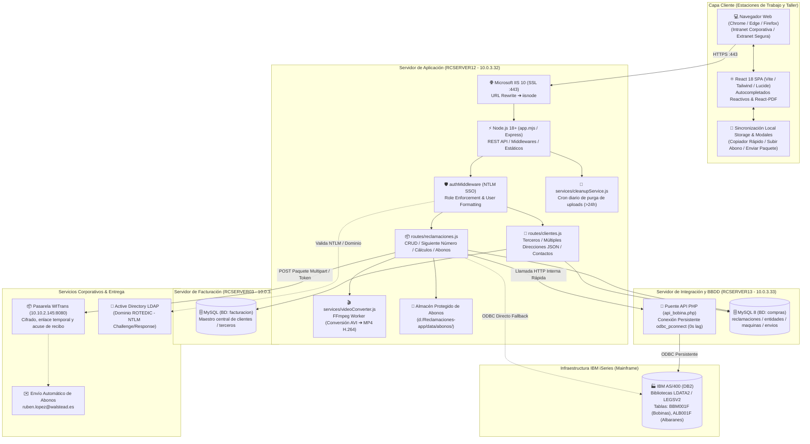
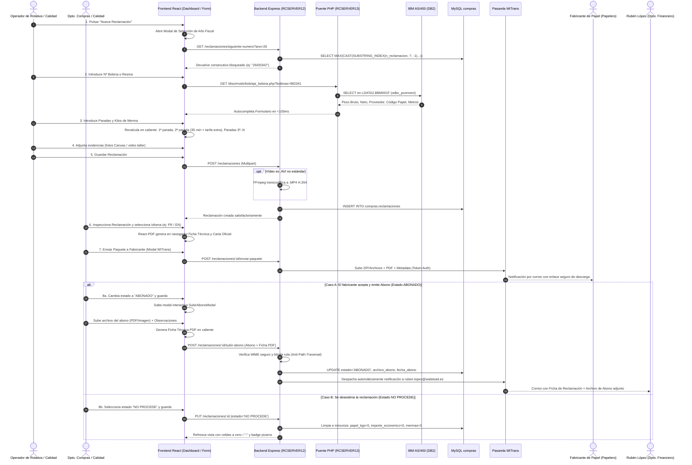
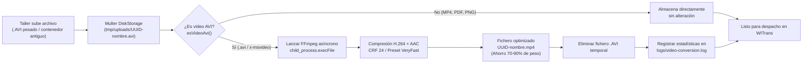
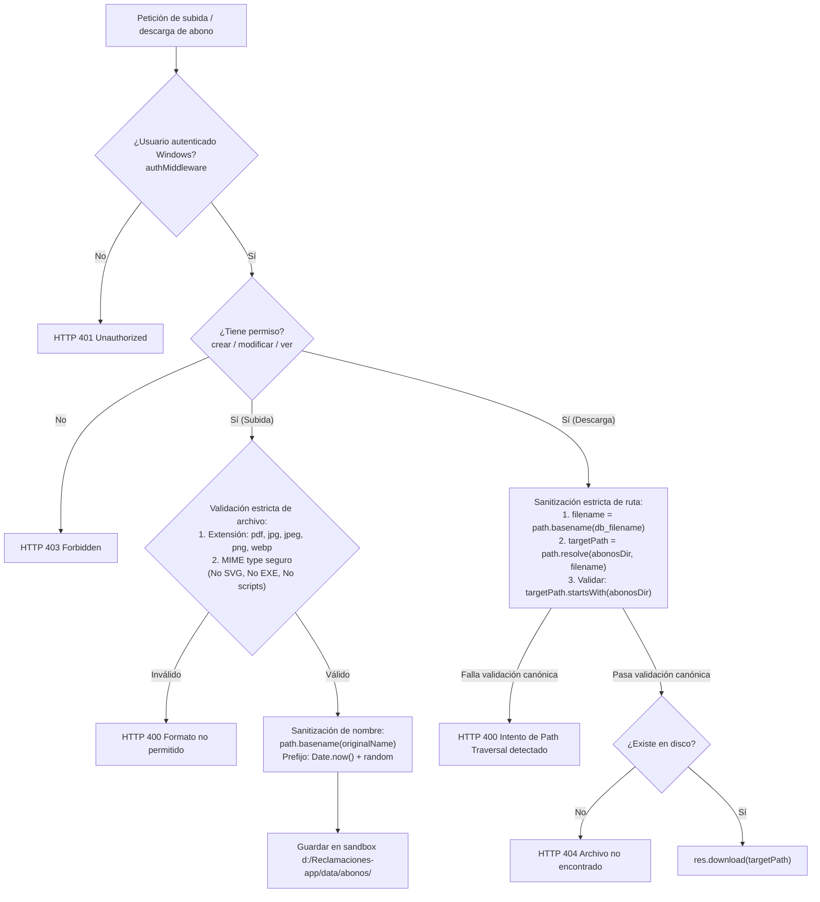

# MANUAL DE ARQUITECTURA, MÓDULOS Y CONEXIONES: SISTEMA RECLAMACIONES-APP

> **Documento de Auditoría y Arquitectura Técnica**  
> **Sistema:** Reclamaciones-app (Gestión Integral de Reclamaciones de Calidad de Papel)  
> **Empresa:** Walstead Iberia (Rotocobrhi S.A.U.)  
> **Servidor Principal de Aplicación:** Microsoft Windows Server (`RCSERVER12` - `10.0.3.32`)  
> **URL Producción:** `https://reclamaciones.walstead.es/`  
> **Ubicación del Código:** `d:\Reclamaciones-app\` (Despliegue sincronizado a `\\rcserver12\node.js\Reclamaciones`)  
> **Stack Técnico:** React 18.2 / Vite 5 / Tailwind CSS / Node.js 18+ / Express / IISNode / MySQL 8 (`compras`) / IBM AS/400 (DB2) / FFmpeg / @react-pdf/renderer / WITrans API  

---

## 1. Resumen Ejecutivo y Propósito del Sistema

**Reclamaciones-app** es la solución web corporativa unificada desarrollada para la planta gráfica de **Walstead Iberia (Rotocobrhi)** destinada a gestionar, valorar económicamente, justificar y tramitar formalmente las incidencias y reclamaciones de calidad detectadas sobre el papel utilizado en los procesos de impresión industrial.

En las rotativas de gran formato (`Litho`, `M-606`, `Rotoman`) y en las máquinas de hoja plana (`KBA`), las roturas de bobina, las variaciones de gramaje, los defectos superficiales o los fallos de bobinado ocasionan graves mermas de materia prima (kilos de papel inservible) y costosas paradas no programadas de taller. 

**Reclamaciones-app** sustituye los antiguos procesos manuales, hojas dispersas y reportes desestructurados mediante un flujo digital blindado que:
1. **Conecta en caliente con el mainframe IBM AS/400 (DB2)** para verificar al instante los datos físicos y contractuales de la bobina (proveedor, gramaje, ancho, peso original, cliente asociado y precio tonelada).
2. **Gestiona tanto Bobinas continuas como Resmas precortadas** (máquina plana KBA con especificación de dimensiones).
3. **Calcula con exactitud matemática el impacto económico real**, combinando el valor del papel arruinado con los costes de parada de rotativa (incluyendo tarifas incrementales horarias de hasta `1.300 €/h` y paradas consecutivas escalables).
4. **Almacena y procesa automáticamente evidencias multimedia**, transcodificando de forma transparente vídeos pesados `.avi` de taller a `.mp4` web estándar mediante **FFmpeg**.
5. **Maqueta y traduce documentos oficiales** (Carta de Reclamación y Ficha Técnica) en 5 idiomas (`ES`, `EN`, `FR`, `IT`, `DE`).
6. **Despacha paquetes certificados a proveedores** a través de la pasarela cifrada de **WITrans**, monitorizando la entrega y trazabilidad de apertura.
7. **Controla el ciclo financiero de abonos**, exigiendo la carga probatoria del justificante bancario de abono, auditándolo contra vulnerabilidades de *Path Traversal* y notificando automáticamente al departamento financiero (`ruben.lopez@walstead.es`).
8. **Gestiona el estado "NO PROCEDE"**, limpiando e inmunizando de forma estricta los importes y pesos para que no distorsionen las auditorías económicas.

---

## 2. Diagramas de Flujo y Arquitectura

### 2.1 Arquitectura General del Sistema y Conexiones de Red



---

### 2.2 Ciclo de Vida Completo de una Incidencia de Calidad



---

### 2.3 Pipeline de Tratamiento de Vídeo y Multimedia con FFmpeg



---

### 2.4 Blindaje de Seguridad en Gestión de Abonos (Anti Path-Traversal)



---

## 3. Análisis Exhaustivo de Módulos Funcionales

### Módulo 1: Gestor de Reclamaciones y Autonumeración Consecutiva (`YY/NNNNN`)
- **Ficheros Core:** `routes/reclamaciones.js`, `frontend/src/components/ReclamacionForm.jsx`.
- **Lógica de Negocio:**
  - Al pulsar sobre "Nueva Reclamación", se presenta un modal flotante con selector de año fiscal (detecta año actual por defecto, ej: `2026`).
  - La numeración adopta la sintaxis `YY/NNNNN` (ejemplo: `26/00045`).
  - El backend ejecuta una consulta optimizada para obtener el número más alto del año solicitado:
    ```sql
    SELECT MAX(CAST(SUBSTRING_INDEX(n_reclamacion, '/', -1) AS UNSIGNED)) as max_num
    FROM compras.reclamaciones
    WHERE n_reclamacion LIKE :prefijo;
    ```
  - El campo `n_reclamacion` se bloquea como `readOnly` en frontend y se valida como inmutable en backend, blindando la integridad referencial.

### Módulo 2: Motor de Paradas Múltiples y Tarifas Horarias Incrementales
- **Ficheros Core:** `routes/reclamaciones.js`, `src/models/Maquina.js`, `ReclamacionForm.jsx`.
- **Lógica de Negocio:**
  - El sistema desglosa los tiempos muertos de máquina en:
    1. **1ª Parada:** Tiempo base de reacción de máquina.
    2. **2ª Parada:** Admite selección predeterminada de **35 minutos** (o tiempo libre). Aplica **tarifas horarias extras incrementales**:
       - `Litho IV y V`: **1.300,00 €/h**
       - `Litho II y VII`: **900,00 €/h**
       - `M-606 y Rotoman`: **700,00 €/h**
       - `KBA / Sunday`: **0,00 €/h** (según condiciones de taller)
    3. **Paradas Adicionales (3ª a N):** Almacenadas en la columna `paradas_adicionales` (array JSON en MySQL) con formato:
       ```json
       [
         { "numero": 3, "horas": 0.5, "coste": 450.00, "kilos": 120 },
         { "numero": 4, "horas": 0.25, "coste": 225.00, "kilos": 50 }
       ]
       ```
  - Suma acumulada reactiva del coste económico total y del pesaje de mermas de papel (`papel_kgs` + `segunda_parada_kilos` + `kilos_adicionales`).

### Módulo 3: Soporte Dual: Bobinas Rotativas vs Resmas Precortadas (KBA)
- **Ficheros Core:** `src/models/Reclamacion.js`, `ReclamacionForm.jsx`, `services/as400.js`.
- **Lógica de Negocio:**
  - Para rotativas continuas (`M-606`, `Rotoman`, `Litho`), la búsqueda se fundamenta en el código de bobina o IFRA, trayendo de AS/400 el ancho, gramaje, metros y tara.
  - Para la máquina de hoja plana `KBA`, el sistema conmuta a modo **Resmas**: se habilita el campo `tamano` (ej: `70x100 cm`), permitiendo la imputación directa de hojas inservibles, peso por millar y costes de guillotinado.

### Módulo 4: Trazabilidad y Normativa Ambiental EUDR
- **Ficheros Core:** `src/models/Reclamacion.js`, `ReclamacionForm.jsx`, `ReclamacionDetalle.jsx`.
- **Lógica de Negocio:**
  - Cumplimiento estricto con el reglamento europeo contra la deforestación (EUDR).
  - Almacena y valida dos campos esenciales:
    - `eudr_dds`: Referencia de la Declaración de Diligencia Debida (*Due Diligence Statement*).
    - `eudr_verificacion`: Código alfanumérico único de verificación aduanera/ambiental del lote forestal.
  - Se incorporan automáticamente en la Ficha Técnica oficial PDF.

### Módulo 5: Generación Multilingüe de PDF Oficiales
- **Ficheros Core:** `ReclamacionPDFDocument.jsx`, `ReclamacionOficialPDFDocument.jsx`, `routes/reclamaciones.js` (`/translate`).
- **Lógica de Negocio:**
  - Emite dos documentos clave mediante `@react-pdf/renderer` ejecutado en el cliente:
    1. **Ficha Técnica (Technical File):** Resumen industrial minucioso de máquina, paradas, mermas, bobinas, datos EUDR y catálogo de evidencias fotográficas.
    2. **Carta Oficial de Reclamación (Claim Letter):** Reclamación mercantil formal dirigida al proveedor/papelero, valorando el importe total demandado.
  - Soporta traducción dinámica en 5 idiomas (`ES`, `EN`, `FR`, `IT`, `DE`). Los nombres de archivo se renombran según el idioma de destino (ej: `Claim_Technical_File_26-00342.pdf` vs `Ficha_Reclamacion_26-00342.pdf`).

### Módulo 6: Hub de Evidencias Multimedia y Transcodificador FFmpeg
- **Ficheros Core:** `services/videoConverter.js`, `routes/reclamaciones.js`.
- **Lógica de Negocio:**
  - Las cámaras de alta velocidad de las rotativas graban vídeos de incidencias frecuentemente en formato contenedor `.avi` con códecs poco comprimidos (ficheros de 100 MB a 400 MB).
  - Al recibirse una subida, `esVideoAvi()` detecta el tipo MIME y lanza en segundo plano `child_process.execFile('ffmpeg')`.
  - Transcodifica a MP4 (H.264 / AAC) con opciones balanceadas de calidad y compresión rápida (`-preset veryfast -crf 24`), logrando reducciones de tamaño del 75% al 90%.
  - Registra el histórico de rendimiento en `logs/video-conversion.log`.

### Módulo 7: Despacho Digital Seguro vía WITrans
- **Ficheros Core:** `EnviarPaqueteModal.jsx`, `routes/reclamaciones.js`.
- **Lógica de Negocio:**
  - Conecta mediante token JWT con el servidor central de transferencia segura **WITrans** (`10.10.2.145:8080`).
  - Genera un paquete con los PDFs, vídeos e imágenes de la reclamación y lo publica con caducidad programada y acuse de recibo.
  - Registra en la base de datos local la fecha de envío, destinatarios, hash del paquete y número de descargas efectuadas por el fabricante.

### Módulo 8: Gestión de Abonos, Notificaciones y Estado "NO PROCEDE"
- **Ficheros Core:** `SubirAbonoModal.jsx`, `routes/reclamaciones.js`.
- **Lógica de Negocio:**
  - **Estado "ABONADO" o "COBRADO":** Al marcar una reclamación con este estado, se abre `SubirAbonoModal.jsx`. Exige la subida del archivo del abono bancario/financiero (PDF, JPG, PNG). Se guarda en `data/abonos/` sanitizando la ruta contra *Path Traversal*. Acto seguido, genera en cliente la Ficha Técnica PDF y despacha automáticamente ambos ficheros a través de WITrans con destino a `ruben.lopez@walstead.es`.
  - **Estado "NO PROCEDE":** Cuando una reclamación se desestima por calidad o acuerdo comercial, se marca como `NO PROCEDE`. El sistema **pone a 0 automáticamente todos los campos económicos y de kilos** (`papel_kgs = 0`, `importe_economico = 0`, etc.), evitando que alteren las estadísticas de mermas de la planta. En las tablas y exportaciones se muestra estéticamente como `"-"` en color slate.

### Módulo 9: Directorio de Terceros y Múltiples Direcciones
- **Ficheros Core:** `routes/clientes.js`, `ClienteDetalle.jsx`, `ClienteForm.jsx`.
- **Lógica de Negocio:**
  - Maestro enriquecido que clasifica a los terceros como `CLIENTE`, `PAPELERO` o `PROVEEDOR`.
  - Soporte de múltiples direcciones por tercero almacenadas en la columna `direcciones` (JSON):
    ```json
    [
      { "id": 1, "tipo": "Fábrica", "calle": "Pol. Ind. Cobrhi 4", "cp": "28340", "poblacion": "Valdemoro" },
      { "id": 2, "tipo": "Sede Central", "calle": "Paseo de la Castellana 120", "cp": "28046", "poblacion": "Madrid" }
    ]
    ```
  - Al generar la Carta Oficial, un diálogo modal interactivo permite al usuario seleccionar qué dirección específica se imprimirá en el membrete del PDF.

### Módulo 10: Exportador Avanzado a Excel Parametrizado
- **Ficheros Core:** `ExportarExcelModal.jsx`, `Dashboard.jsx`.
- **Lógica de Negocio:**
  - Modal interactivo con selector modular de hasta 26 campos.
  - Filtros directos por Cliente, Papelero, Estado, Máquina y Rango de Fechas.
  - Garantiza la agrupación y orden estricto de las columnas económicas:
    $$\text{Importe Cobrado} \longrightarrow \text{Importe Pendiente} \longrightarrow \text{Importe Total} \longrightarrow \text{Seguimiento Interno}$$
  - Salida formateada en CSV con cabecera UTF-8 BOM (`\uFEFF`) para compatibilidad directa e inmediata con Microsoft Excel.

---

## 4. Arquitectura de Integraciones y Sistemas Externos

| Sistema / Servicio | Host / IP | Protocolo / Driver | Propósito y Capacidades |
| :--- | :--- | :--- | :--- |
| **IBM AS/400 (DB2)** | Mainframe Corporativo | IBM iSeries DB2 / ODBC (`LDATA2`, `LEGSV2`) | Tablas maestras de bobinas (`BBM001F`) y albaranes de papel (`ALB001F`). Consulta de gramajes, anchos, metros, proveedores y clientes. |
| **Puente PHP AS/400** | `10.0.3.33` (`RCSERVER13`) | HTTP REST + `odbc_pconnect` (`api_bobina.php`) | Canalizador de persistencia rápida que evita el retraso de handshake de conexión ODBC de 64 bits en `rcserver12`. |
| **MySQL compras** | `10.0.3.33:3306` (`RCSERVER13`) | MySQL 8 via Sequelize ORM | Almacén de reclamaciones, contactos de terceros, paradas, historial de envíos y configuración de máquinas de taller. |
| **MySQL facturacion** | `10.0.3.42:3306` (`RCSERVER03`) | MySQL via Sequelize (Solo Lectura) | Consulta del maestro corporativo de clientes y terceros centralizado en Facturación. |
| **Pasarela WITrans** | `10.10.2.145:8080` | HTTP Multipart REST + Token | Subida cifrada de evidencias pesadas, generación de enlaces temporales seguros y acuse de recibo de descargas de fabricantes. |
| **Active Directory LDAP** | `10.0.3.31` / `RCSERVER14` | NTLM / LDAP Port 389 (Dominio `ROTEDIC`) | Autenticación integrada de Windows (Single Sign-On). Identifica al operador y formatea nombres (`Apellido, Nombre`). |
| **FFmpeg Converter** | Local (`RCSERVER12`) | CLI binario (`child_process.execFile`) | Transcodificación de vídeo `.avi` ➔ `.mp4` con códec H.264/AAC en background para aligerar la carga de red. |

---

## 5. Diccionario de Datos y Modelos Principales

### 5.1 Tabla Principal: `compras.reclamaciones`

| Campo | Tipo | Nulo | Descripción / Regla de Negocio |
| :--- | :--- | :---: | :--- |
| `id` | `INT` | ❌ | Identificador primario autoincremental local. |
| `n_reclamacion` | `VARCHAR(20)` | ❌ | Código fiscal correlativo inmutable (formato `YY/NNNNN`). |
| `planta` | `VARCHAR(50)` | ✔️ | Planta de producción de origen (ej: `Rotocobrhi`). |
| `fecha` | `DATE` | ✔️ | Fecha del registro de la incidencia. |
| `cliente` / `encargo` | `VARCHAR` | ✔️ | Razón social del cliente y número de orden de taller. |
| `producto` | `VARCHAR(200)` | ✔️ | Título o descripción del encargo gráfico impreso. |
| `cod_papel` / `denominacion` | `VARCHAR` | ✔️ | Código interno y nombre comercial del papel. |
| `papelero` | `VARCHAR(120)` | ✔️ | Nombre del fabricante o distribuidor de papel reclamado. |
| `ancho` / `gramaje` | `DECIMAL` | ✔️ | Ancho en centímetros (`DECIMAL(7,2)`) y gramaje en $g/m^2$ (`DECIMAL(6,1)`). |
| `tamano` | `VARCHAR(100)` | ✔️ | Dimensiones en cm para resmas en máquina plana KBA. |
| `importe_economico` | `DECIMAL(10,2)` | ✔️ | Importe económico total reclamado (papel + paradas + extras). |
| `importe_papel` | `DECIMAL(10,2)` | ✔️ | Coste directo imputado exclusivamente al material estropeado. |
| `papel_kgs` | `DECIMAL(10,2)` | ✔️ | Peso total en kilogramos del papel defectuoso reclamado. |
| `importe_aceptado` | `DECIMAL(10,2)` | ✔️ | Cantidad reconocida y acordada formalmente con el fabricante. |
| `importe_abonado` | `DECIMAL(10,2)` | ✔️ | Importe liquidado en cuenta bancaria mediante nota de abono. |
| `importe_rechazado` | `DECIMAL(10,2)` | ✔️ | Cantidad desestimada por el papelero. |
| `importe_pendiente` | `DECIMAL(10,2)` | ✔️ | Saldo pendiente de resolución (`importe_economico - importe_abonado`). |
| `estado` | `ENUM` | ✔️ | `EN PROCESO`, `ACEPTADO`, `RECHAZADO`, `COBRADO`, `ACEPTADO Y PROCESO`, `COBRADO Y PROCESO`, `DESCONTADO`, `DUPLICADO`, `ABONADO`, `NO PROCEDE`. |
| `segunda_parada_tiempo` | `INT` | ✔️ | Tiempo de la 2ª parada en minutos (admite 35 min). |
| `segunda_parada_coste` | `DECIMAL(10,2)` | ✔️ | Coste calculado aplicando tarifas horarias incrementales. |
| `segunda_parada_kilos` | `DECIMAL(10,2)` | ✔️ | Kilos de merma generados durante la 2ª parada. |
| `paradas_adicionales` | `JSON` | ✔️ | Array JSON con desglose de paradas 3ª a N (horas, coste, kg). |
| `kilos_rechazo` | `DECIMAL(10,2)` | ✔️ | Kilos desestimados de la reclamación. |
| `eudr_dds` / `eudr_verificacion`| `VARCHAR(100)` | ✔️ | Códigos de Diligencia Debida y Verificación de trazabilidad forestal EUDR. |
| `archivo_abono` | `VARCHAR(255)` | ✔️ | Nombre seguro del justificante de abono alojado en `data/abonos/`. |
| `fecha_abono` | `DATE` | ✔️ | Fecha efectiva de recepción del abono. |
| `maquina_id` | `INT` | ✔️ | Clave foránea referenciando a `compras.maquinas`. |

---

## 6. Seguridad, Hardening y Control de Acceso

1. **Autenticación Windows Integrada (NTLM SSO):**
   - Sin almacenamiento de contraseñas ni tokens JWT expuestos en cliente.
   - En desarrollo, el backend ejecuta el apretón de manos NTLM directo con el controlador de dominio.
   - En producción, IIS valida la cabecera `LOGON_USER` de Windows Authentication y la traslada mediante variables de servidor a `iisnode`.
2. **Matriz de Permisos Basada en Roles (`config/permissions.json`):**
   - Perfiles: `admin`, `editor`, `compras`, `operador`, `pendiente`.
   - Cualquier usuario nuevo del Dominio que entre al sistema se enrola de forma preventiva como `pendiente` (sin permisos) hasta su aprobación explícita por Compras/Sistemas.
3. **Inmunización contra *Path Traversal* (CWE-22 / CWE-73):**
   - Tanto la subida como la descarga de archivos de abono están blindadas:
     - `path.basename` elimina secuencias peligrosas (`../`, `..\\`).
     - Validación canónica con `path.resolve` comprobando que la ruta destino comience indefectiblemente por `path.resolve(__dirname, '../data/abonos')`.
4. **Validación Estricta de Formatos y Cabeceras MIME:**
   - Para abonos: se permiten únicamente `PDF`, `JPEG`, `PNG` y `WebP`. Se bloquean taxativamente extensiones activas o con riesgo de ejecución (`SVG`, `HTML`, `EXE`, `BAT`, scripts).
   - Para evidencias multimedia: limitación a 500 MB por fichero en Multer y transcodificación aislada.

---

## 7. Runbook Operativo, Despliegue y Mantenimiento

### 7.1 Arranque y Modos de Ejecución
- **Desarrollo:**
  - Frontend: `npm run dev` en `frontend/` (puerto `3000` con Hot Module Replacement).
  - Backend: `node app.mjs` en raíz (puerto `3020`).
  - Automatizado con un solo clic mediante [arrancar.bat](file:///d:/Reclamaciones-app/arrancar.bat).
- **Producción:**
  - Compilación optimizada del frontend con Vite: `npm run build` en `frontend/` (genera bundle en `frontend/build/`).
  - Servidor Express en `app.mjs` sirve tanto la API REST `/api` como los estáticos compilados de la SPA de forma nativa.
  - Sincronización a servidor `RCSERVER12` mediante `node sync-production.mjs`.
  - IIS y IISNode gestionan el proceso de Node.js bajo `web.config` con reciclado automático y logs en `/iisnode`.

### 7.2 Servicio Desatendido de Purga de Temporales
- El servicio `services/cleanupService.js` se ejecuta cíclicamente cada 24 horas.
- Inspecciona la carpeta `tmp/uploads/` y elimina automáticamente cualquier archivo residual con antigüedad superior a 24 horas derivado de procesos de subida o conversiones inconclusas.

### 7.3 Monitorización y Registros de Auditoría
- **Logs de Vídeo:** `logs/video-conversion.log` audita cada proceso de compresión de FFmpeg (tiempo empleado, tamaño inicial, tamaño final y ratio de compresión).
- **Logs de Servidor:** Centralizados mediante logger estructurado (`pino` / winston) por módulos (`routes-reclamaciones`, `routes-clientes`, `as400`).
