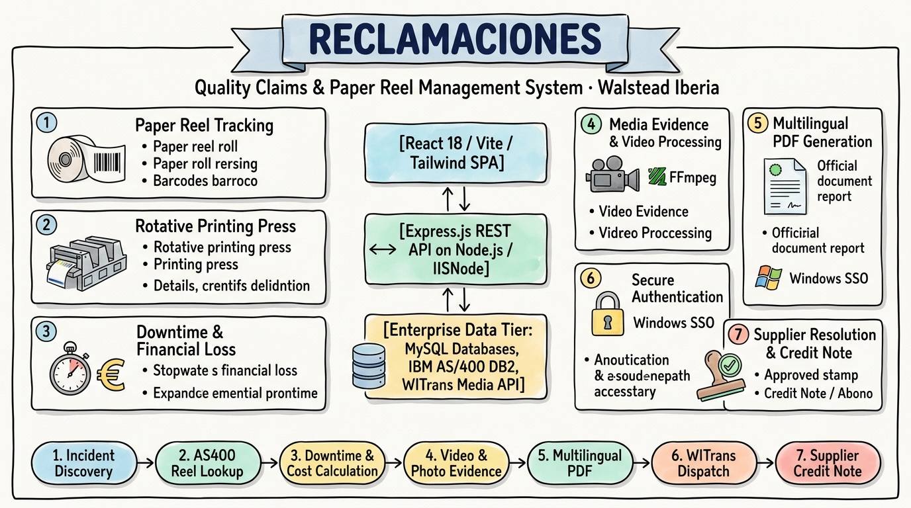
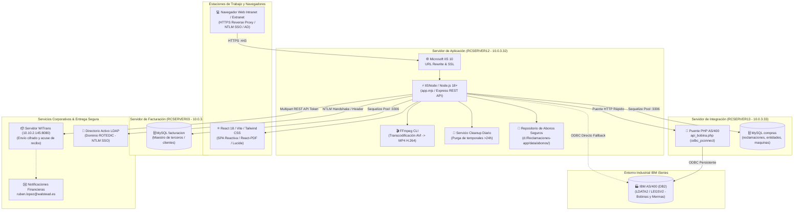
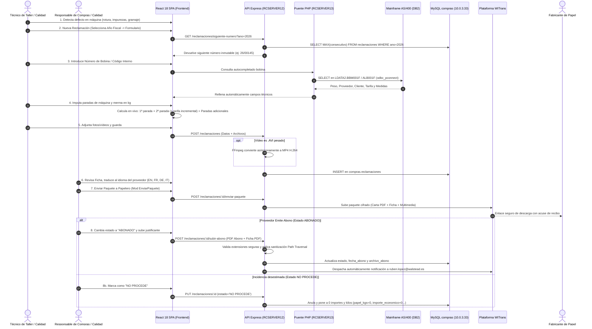

# 📝 Reclamaciones-app — Sketchnote & Lámina de Arquitectura Técnica

> **Reclamaciones-app** es la plataforma web corporativa (**React 18 SPA + Node.js / Express + IISNode**) desarrollada para **Walstead Iberia (Rotocobrhi)**, diseñada para digitalizar, auditar y automatizar de extremo a extremo la trazabilidad, valoración económica y envío de **reclamaciones de calidad sobre bobinas y resmas de papel**, integrando en tiempo real el mainframe industrial **IBM AS/400 (DB2)**, repositorios locales en **MySQL (`compras`)**, transcodificación multimedia con **FFmpeg** y distribución segura vía **WITrans**.

---

## 🎨 Lámina Visual de Arquitectura (Handwritten Notes)

---

## 🏗️ Topología de Infraestructura y Servidores

---

## 🧩 Módulos Funcionales Clave

| # | Módulo | Ficheros Core | Rol y Capacidades Técnicas |
| :---: | :--- | :--- | :--- |
| **1** | **Gestor de Incidencias & Autonumeración** | `routes/reclamaciones.js` `ReclamacionForm.jsx` | Generación secuencial inmutable de código de reclamación fiscal (`YY/NNNNN`). Soporte dual para **Bobinas** continuas y **Resmas precortadas para máquina KBA** con validación estricta. |
| **2** | **Puente Industrial AS/400 (DB2)** | `services/as400.js` `api_bobina.php` (RC13) | Consulta en tiempo real de pesos brutos/netos, metros, proveedores y albaranes en tablas `LDATA2/LEGSV2`. Mecanismo de alta velocidad mediante conexiones persistentes PHP en `rcserver13`. |
| **3** | **Motor de Paradas Múltiples y Mermas** | `ReclamacionForm.jsx` `routes/reclamaciones.js` | Cálculo dinámico de 1ª parada, 2ª parada (con opción de **35 min**) y paradas adicionales consecutivas (3ª, 4ª...) con tarifas horarias incrementales (`700 €/h` a `1.300 €/h`) y suma de merma en kg. |
| **4** | **Evidencias y Pipeline FFmpeg** | `services/videoConverter.js` `routes/reclamaciones.js` | Subida drag & drop con compresión en cliente de imágenes (Canvas) y transcodificación asíncrona de vídeo pesado (`.avi`) a formato estándar Web `.mp4` H.264 para aligerar envíos. |
| **5** | **Informes PDF Multilingües** | `ReclamacionPDFDocument.jsx` `ReclamacionOficialPDFDocument.jsx` | Generación client-side con `@react-pdf/renderer` de la **Ficha Técnica** y la **Carta Oficial** maquetadas para impresión corporativa y traducidas a 5 idiomas (`ES`, `EN`, `FR`, `IT`, `DE`). |
| **6** | **Despacho Digital WITrans** | `EnviarPaqueteModal.jsx` `routes/reclamaciones.js` | Empaquetado y subida cifrada con token hacia la pasarela WITrans (`10.10.2.145:8080`), registrando acuses de recibo y log de descargas por parte de proveedores papeleros. |
| **7** | **Módulo Financiero de Abonos & "No Procede"** | `SubirAbonoModal.jsx` `routes/reclamaciones.js` | Detección de estado "Abonado/Cobrado", subida segura con sandbox contra *Path Traversal*, acoplado a la Ficha Técnica PDF y despacho automático a `ruben.lopez@walstead.es`. Manejo del estado `'NO PROCEDE'` con vaciado de importes. |
| **8** | **Directorio de Terceros y Múltiples Direcciones** | `routes/clientes.js` `ClienteDetalle.jsx` | Maestro de Clientes, Papeleros y Proveedores. Almacenamiento JSON de direcciones múltiples (Fábrica, Almacén, Fiscal) con selector interactivo para el estampado en cartas oficiales. |
| **9** | **Exportador Modular Excel Parametrizado** | `ExportarExcelModal.jsx` `Dashboard.jsx` | Exportación CSV con UTF-8 BOM, filtros combinados y selección de hasta 26 campos configurables, garantizando el bloque financiero contiguo (`Importe Cobrado` ➔ `Pendiente` ➔ `Total` ➔ `Seguimiento`). |
| **10** | **SSO Windows NTLM y Control de Acceso** | `authMiddleware.js` `permissions.json` | Autenticación integrada corporativa sin JWT basada en Active Directory Windows. Roles estrictos (`admin`, `editor`, `compras`, `operador`, `pendiente`) y formateo automático de nombres. |

---

## 🔄 Ciclo de Vida de una Reclamación de Calidad

---

## ⚡ Motor de Cálculo de Costes y Paradas de Taller

El coste total de una reclamación de papel integra tanto el valor de la merma de material como el lucro cesante por parada de rotativa:

$$\text{Coste Papel (€)} = \text{Kilos Papel} \times \left(\frac{\text{Precio Tonelada}}{1000}\right)$$

$$\text{Coste 1ª Parada (€)} = \left(\frac{\text{Minutos 1ª Parada}}{60}\right) \times \text{Tarifa Base Máquina (€/h)}$$

$$\text{Tarifa 2ª Parada (€/h)} = \text{Tarifa Base} + \text{Tarifa Extra Incremental}$$

$$\text{Coste 2ª Parada (€)} = \left(\frac{\text{Minutos 2ª Parada (ej: 35m)}}{60}\right) \times \text{Tarifa 2ª Parada}$$

$$\text{Coste Paradas Adicionales (€)} = \sum_{i=3}^{n} \left(\text{Horas}_i \times \text{Tarifa}_i\right)$$

$$\text{Coste Total Reclamado (€)} = \text{Coste Papel} + \text{Coste 1ª Parada} + \text{Coste 2ª Parada} + \text{Coste Paradas Adic.} + \text{Otros Costes}$$

### Tarifas Horarias Incrementales de Rotativa:
- **Litho IV y V:** `1.300,00 €/h`
- **Litho II y VII:** `900,00 €/h`
- **M-606 y Rotoman:** `700,00 €/h`
- **KBA (Plana) y Sunday:** Tarifa configurable según pliego de condiciones de taller.
